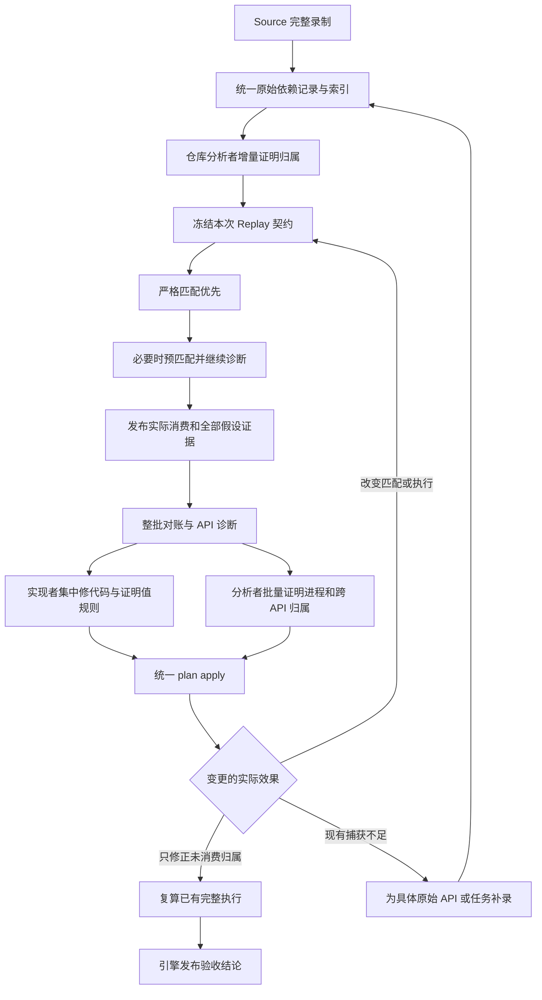

# 依赖录制归属与预匹配架构设计

本方案以完整录制批次为证据边界，把原始流量、归属证明、规则假设、实际消费和验收结论分开管理。目标是让 Target 实现者尽快完成代码，一次 Replay 尽可能取得完整诊断，集中证明和应用规则，复用当前录制形成结论。补录只承担现有证据确实无法覆盖的工作。

采用新的录制和工作流语义，允许围绕该目标重构。新读写链路替换旧链路，不保留双格式读取、旧 Global 兜底、旧报告迁移或完成时归属。旧文件不改写、不删除；新引擎明确拒绝旧格式。保持单 Rust crate、Tokio、协议线格式和 TLS 安全边界；时间、身份、加密见证与协议解析继续复用已有责任模块。

## 核心约束

1. 每个已接入的 Source 语义请求和 Target 实际请求都留下独立记录，成功、失败、取消和不完整捕获均有去向。未归属是一种正式证据状态。
2. 原始观察位置与业务归属分别记录。流量发生在 Case B 窗口内，不代表它一定由 B 发起。
3. 归属证明可以改变义务由谁承担，不能生成响应、实际消费或完整执行的事实。
4. 预匹配可以在有界假设下继续诊断。每个尝试过的假设均有记录，是否采用与是否证明分别表达。
5. 同一 Replay session 内，一个有限 Source 发生项只能被占用一次，一个 Target 请求只能取得一个合法对应。响应实际交付和所需终止完成后才算消费。
6. 候选发现、归属确认、实际消费和验证通过使用不同状态，不能用一个 `matched` 或 `verified` 布尔值替代。
7. API 可以先取得有明确范围的结论；整批通过仍要求所有相关任务、归属与消费义务闭合。

## 整体流程



对单个 Target 请求，整批索引只能提供调查候选。查找限定在同一录制 run 的 Case、startup、process 和 unattributed 范围，不把其他批次混进当前库存。没有已确认的归属或显式共享权限，不能因为其他 Case 存在相同 SQL、URL 或 Redis key 就借用其响应。

## 统一证据模型

### 录制事实

一个 recording run 可以包含多个实际进程启动周期，每个周期有独立的 `process_epoch`。所有请求在接入时分配 run 内唯一 `exchange_id`，并保存协议原生配对引用。

| 对象 | 必要内容 |
| --- | --- |
| Run | 录制 schema、Source 启动入口文件身份、采集配置身份、输入清单、进程周期、完整性 |
| Exchange | 唯一身份、协议原生引用、开始和终止时钟、发生阶段、接入时观察到的 Case、请求与响应引用、结果、捕获完整性 |
| Effect | 同一物理请求内的语义子项，引用 `exchange_id + effect_index` |
| Input | 原始 API 输入、已观察的外部输入或任务触发；保留可比较执行边界 |

HTTP stream、MySQL query、Redis command、Memcached request、Motan call、Kafka request 都保留各自协议配对和顺序。Kafka 一个物理请求中的多条消息使用 Effect，不重复计为多个物理调用。主动推送单独建观察项，并保留订阅或回调因果引用。原始 TCP/UDP 记录其真实传输粒度，不能假称完整业务请求。

语义请求、连接或会话控制、主动通知、捕获故障明确标明种类。协议调试镜像不另算业务请求。维护命令和快照命中仍保留发生事实及处理依据，不再通过过滤悄悄消失；是否构成业务消费义务由明确契约决定。

### 归属决策

归属账本只追加决策和撤销记录，原始 Exchange 永不随归类而修改。归属结果为：

```text
Attributed:
  startup(process_epoch, initialization_unit)
  case(origin_case_id, optional_task_instance)
  process(process_epoch, source_task, optional_invocation)

Unattributed:
  reason
  candidate_owners
  missing_evidence
```

每项决策绑定原始引用或经完整覆盖检查的范围，以及归属依据。依据分为引擎签发的录制范围契约与独立 Source 证明：前者绑定进程周期、原子接入边界、隔离/完成契约和库存完整性；后者还绑定 Source 版本、证明版本、调用链、请求条件及规则效果版本。冲突决策不能同时成为当前有效归属；存在争议而无法唯一确认时保持 Unattributed。

`phase=startup/runtime/shutdown` 只说明发生阶段。进程任务可以在 startup 阶段运行，但其 owner 仍是 process；startup owner 专指已界定的初始化工作。API 启动的异步业务归原始 Case，不再借用 process-owned 表达。

引擎按冻结录制契约批量建立基础归属：单 Case 接入范围内默认归该 Case，已界定初始化归 startup，已证明 process 规则命中项归相应任务，其余保留 unattributed。基础归属可用于常规 Replay 与验收，不要求分析者为每条普通依赖额外证明；它仍是范围契约，不冒充运行时调用者追踪。

发现归属冲突、修改 owner/消费义务或扩大跨 Case 响应范围时，必须取得独立 Source 证明，不能继续仅凭发生时间维持结论。原始观察位置始终保留，所有修订均可追查。

### Target 观察与实际消费

每次实际 Replay 具有独立 `session_id`，Target 每个真实请求具有 `observation_id`。配对与消费以 `(session_id, source_exchange_id)` 为单位，不能在录制批次上永久占用，也不能把多个失败尝试的消费拼起来。

消费状态统一为：

```text
available → claimed → delivering → awaiting_termination → consumed
                         └──────────────────────────────→ failed
```

不需要等待额外终止的协议可从 delivering 进入 consumed。claim 失败或 materialization 失败均不制造消费；真实交付开始后不能撤销选择、换一份响应或回滚 Target。

归属证明、假设记录和报告重分类都无权写入 consumed。显式共享或快照权限单独建使用契约及使用记录，不把普通有限 Exchange 默认变成无限响应。

## 存储与索引

采用一个中央语义账本。以下路径为新格式布局：

```text
<recording-run>/
  recording-run.json
  dependency-manifest.json
  dependencies.jsonl
  dependency-lifecycle.jsonl
  apis/.../<case-id>/
    request.json
    expected-response.json
    dependency-scope.json
  indexes/startup-scope.json
  indexes/process-scope.json
  indexes/unattributed-scope.json
```

`dependencies.jsonl` 每个终结的语义观察只写一次。`dependency-lifecycle.jsonl` 保存接入、终止、故障和 seal 事实，用于恢复未完成捕获及核对库存；它与语义记录通过唯一身份关联，不另计依赖数量。协议请求与响应内容保留在中央原始记录中，不复制大响应到多个 Case。Target 见证由独立的受保护证据存储保存。

startup、各 Case、process、unattributed 是索引和归属视图。它们引用中央事实，不再各保存一份可独立变动的完整依赖。原始内容身份、归属修订和 Replay 证据分别封存。

`dependency-manifest.json` 显式列出输入、数据文件、索引版本、内容身份、各类观察数量以及完整性；`recording-run.json` 保存录制工作状态。Source 入口文件哈希只标识实际启动文件，不代表整个构建闭包；不可取得时显式记录 unavailable。发现录制文件使用 manifest，禁止继续通过“目录下存在 dependencies.jsonl 就是一份 Case”推断。旧的隐式 Case/Global 两类加载器直接移除。

封存状态与捕获完整性独立：sealed 只证明文件及其内容身份已固定，不保证所有工作都捕获完整。已封存但局部不完整的批次可用于调查；原始证据、必要输入及关联义务均完整的独立 API scope 可取得局部结论，缺失范围保留待办，整批不能据此通过。未封存文件不能作为正式 plan/apply 证据。

完整性缺口分为“已知 Exchange 的内容不完整”和“可能遗漏整个观察项的库存缺口”，保存受影响进程周期、输入/时间范围及已知身份。局部验收必须证明 API 输入、相关 startup/process 前置义务、归属覆盖和所有依赖引用均完整，并与缺口无关。无法定位影响范围的队列丢失等问题阻塞可能受影响的整个 epoch，不能仅凭现有记录数量推断完整。

归属 overlay 与分析缓存放在派生工作目录。Replay session 独立保存 Target 见证、假设尝试、决策和消费回执；原始 Source 与实际 Target 内容继续复用已有认证见证及引用机制。

## 录制生命周期

### 所有协议在请求开始时登记

协议解析器识别接入请求后，在转发前分配身份，保存 epoch、phase、观察 Case 和原生序号，并建立 run 级 capture reservation。符合 Case 接入条件时，再持有 Case reservation。响应和终止始终使用该身份，不在完成时重查 active Case。

观察到某个 Case 仍占用槽位，与获得该 Case 的 dependency admission 分开记录。Case 已关闭接入但仍在 drain 时，新请求可以保留该观察上下文，却不能据此获得默认 Case 归属。

run reservation 与业务 owner 无关。归为 process 或 unattributed 不能释放捕获屏障。开始登记、Case 接入和关闭接入共同遵循一个原子顺序，使边界前后可确定。

写入可以有界批处理，不要求每个字段单独 fsync。队列拒绝、写盘或封存失败必须令库存不完整并停止正常发布，不能只打一条日志继续宣称录制完成。

### 普通 API

主响应完整结束时立即关闭新依赖接入，固定宽限为 0ms。已接入请求仍保留原身份，等待真实响应、终止和写入完成后封存 Case。

首版继续单 Case 接入：上一 Case 的实际 drain 和发布完成后，才接纳下一 Case。取消 100ms 不等于跳过真实在途请求；不另加 5ms 概率窗口。

关闭后才开始的调用照常进入中央账本，保留接入时上下文；没有已证明 owner 时进入 unattributed。晚到依赖不重新打开已封存 Case，其归属由后续证明修订。

### 异步 API

继续只声明 `when / when_response / end`。不同请求走到的实际依赖由录制自动收集，不提供“小于三条列完整依赖”的模式。

```text
PrimaryActive
  → PrimaryComplete + AwaitEnd
  → 场景已确定且观察到可信 end
  → 原子关闭接入
  → drain
  → sealed
```

end 早于主响应结束时只锁存信号。主响应完整结束、Source 场景确定和 end 成立三个条件同时满足后，才能关闭接入；已经返回主响应后命中的 end 在同一接入锁下关闭。

可信 end 必须是归属于当前工作单元、完整满足终点条件的真实 Exchange。早到信号按候选场景分别锁存，最终只使用 Source 选中的场景；进程任务的同名操作、另一任务的相同 SQL/key 或失败的终点尝试不能自动关闭。若现有范围和 selector 无法排除混淆，收窄条件或补充可证明的任务身份。

协议成功与业务成功分别判断：成功写入 `status='failed'` 可以是业务终点；HTTP 503、SQL deadlock 等失败尝试保留为重试轨迹。事务内完成标志还必须满足 Source 要求的提交边界，不能在 UPDATE 返回成功、事务尚未 COMMIT 时结束采集。

end 必须代表整个工作单元完成。多个 end 为可替代终点，任意一个命中即可；并行工作应选择汇合后的最终标志。end 后的 drain 只补完已接入 I/O，不能证明后续调用链已经结束。

完整录到的 HTTP 错误、Redis ERR、SQL deadlock 或连接失败保留在轨迹中，允许应用自行恢复、退避、重试并最终到达 end。采集损坏、协议无法继续记录、writer 失败和主响应截断进入失败隔离。

使用从原始主请求开始计算的绝对预算。到期记录 `business_completion=unobserved` 并停止 Source，保留真实清理边界；`capture_complete`、`business_complete` 和 `replayable` 分开表达。完整捕获一个停止过程不代表业务正常完成。

### 停止与封存

关闭新输入 → 完成当前业务观察或到达停止预算 → 停止 Source 并确认进程退出 → 结束保留连接并记录真实终止 → 确认请求产生者结束，原子关闭新的 capture 登记 → 排空整个 run 的既有请求和 writer → seal。

这条屏障覆盖 startup、process、Case 和 unattributed。每个已接入身份必须对应正常完成、真实 peer 终止、捕获失败或明确的停止时不完整记录；不得消失。强制终止、预算耗尽和持久化失败必须在 manifest 中反映。

封存前逐项核对：每个 admitted 身份恰有一个 terminal outcome；lifecycle 与语义记录不冲突；正常终结项有唯一完整语义行；故障、清理和残片的引用均可解析。普通 Case drain、进程停止、连接终止与 writer drain 使用独立清理预算，清理活动不续期异步业务的绝对预算。

## 通用预匹配

### 协议投影与共同值语义

协议适配器提供结构签名与带原始位置的 typed values；共同预匹配只处理值及候选规则，不能替代协议解析或重新解释 wire 数据。

| 载体 | 原始位置与保留约束 |
| --- | --- |
| JSON | JSON pointer、成员集合、数组长度和顺序、标量类型 |
| MySQL | 文本 SQL 字面量或 typed params，保留 token、参数索引和可证明的 database/table/column；JSON 值进一步定位 pointer |
| Redis args | 命令、原始 arg index、参数语义和类型；值中的 JSON 进一步定位 pointer |
| Redis key | 原生 key slot、固定结构和变量槽位；多 key 的数量、位置和顺序保留 |

MySQL 文本请求和预编译请求复用已有 token materialization、精确 decimal、NULL/bytes 和字段绑定。同一 wire 形式的 typed params 保留数量和 kind 校验；文本与预编译形式之间比较完整绑定后的 SQL 结构及 native 值槽位，不要求原始 params 数组等长。SQL 关键字、物理结构、操作符、绑定完整性和语义值类型不能靠猜测放宽。

Redis 复用 key slots、正式 key formats、时间窗和脚本身份。key 的生成 ID/时间片段可提出假设，固定部分、命令、选项和未解释参数仍严格。身份映射优先复用已有关系，再考虑建立新假设。

候选生成复用 `value_contract/time`、`identities`、JSON/native scalar 和既有模板验证。一个 Case/已证明工作单元内，相同 Source 身份在 SQL、JSON、Redis args/key 中共享有来源的对应关系；类型转换和嵌入模板必须有明确规则，不用字段名相同推断关系。

优先覆盖 UUID、可验证时间、已知 native temporal 类型、已建立身份关系和有结构依据的 key 片段。一般整数 ID、TTL、签名、编码等逐机制定义候选条件；不能把“看起来像 id/time”直接作为权限。已有正式规则失败时，假设不能覆盖其失败。

### 候选选择与执行

1. 按已冻结 owner 或授权共享范围、endpoint、协议、会话/事务、lane 和硬结构限定候选。
2. 在允许的范围内完整寻找严格匹配，严格匹配优先于所有假设。
3. 无严格匹配时生成有界 typed hypotheses。一个请求可同时解释多处值差异。
4. 联合预览整个请求、身份提案和可交付响应；所有差异都解释成功才可选择。
5. 选择必须由唯一合法候选或协议原生 next-slot 唯一确定。稳定排序和相似度不能解决多解；有多解则停止该路径并返回冲突证据。
6. 记录决策、原子 claim Source slot 并提交本会话的 staged identity；完成准备后开始真实交付。
7. 交付开始后不回溯、不换响应。发生后续冲突时结束这条诊断路径并发布已有信息。

有限消费状态只由真实 I/O 更新。预匹配过程中建立的身份关系标明假设来源，后续使用可追查；正式验证使用全新 Target/session，不带入诊断会话中的临时绑定。

初版不构建分支搜索或 Target 内存回滚执行器。不能安全推进的请求形成明确硬阻断；单纯关闭 fail-fast 而没有合法响应，无法产生有价值的后续执行。

## 所有假设独立留证

假设尝试记录与实际匹配提交分离。纯比较器返回值比较结果和有界诊断轨迹；证据层在访问候选时保留尝试记录，不能等完整候选 commit 后才保存。

| 维度 | 状态 |
| --- | --- |
| 尝试 | generated、tried、rejected、selected、claim_applied、delivery_started |
| 证明 | unreviewed、source_confirmed、refuted、stale |
| 验证 | diagnostic_only、applied_pending_replay、verified |

每条记录包含：候选与尝试身份、session/work scope、Target observation、Source 引用、协议和具体位置、规则草案、采用/拒绝理由、依赖的上游假设、是否影响执行、证明要求、受保护见证入口。

同一规则可以聚合多次尝试，但不同尝试的结果不能覆盖彼此。前一个字段可解释、后一个字段失败，前一个猜测仍留下；未选中候选和已证伪候选也保留。只考虑过而未影响执行的猜测，不单独令严格通过的 Case 失败。

成功、dirty、失败、超时和受控中断统一发布实际观察、所有猜测、消费结果与剩余阻断。崩溃恢复读取最后完整日志记录并明确未完成。证据预算耗尽停止继续假设，标明覆盖不完整，不悄悄省略后宣称“已返回全部”。

结束发布前先关闭新匹配接入，收齐已经执行的有界比较轨迹及其终态，排空假设和决策日志，再 seal/publication。相关决策日志取得持久化确认后才能开始依赖响应交付。受控超时不能直接取消并丢弃尚未返回的比较结果；清理预算内无法收齐或写入失败时明确覆盖不完整。真实 I/O 的终止与消费仍按自己的屏障保留。

任何用于真实交付的未证明假设都会阻止正式通过。Source 证明和离线 payload 检查不能把曾受假设影响的执行直接升级为正式验证；批量发布规则后执行一次新的正式 Replay。

是否需要再次执行取决于真实执行内容：一轮以诊断为目的的 Replay 若实际没有使用未证明假设，全部正式检查也已满足，可以直接产生验收回执；不为把运行名称从“诊断”改为“正式”而额外重跑。

## 整批归属与依赖对账

### 执行边界

当前实现以一份 sealed Source run 为批次原子单位，不拼接多份历史录制。对账首先声明输入集合、Source/Target 启动周期、任务触发及观察边界。完整批次结算使用同一次实际完整验证 session；API focused replay 的结论保留其自己的 scope，不能把多个历史 attempt 拼成一次整批通过。

startup-once 任务按每个 epoch 验证。周期进程任务要求明确的逻辑触发或可比较生命周期，不能直接比较 Source 运行一小时与 Target 快速执行几十秒的总次数。没有可比较触发证据时，记录该任务覆盖未完成，不自动认定代码错，也不把它改成无限 Global 响应。

### Source 与 Target 两个方向

Source 对账展示全部发生项、有效归属、应承担的消费义务与真实消费回执。Target 对账展示每个实际请求、候选访问、最终配对、交付和终止状态。

未消费表示录制发生项尚未被本次执行消费；未匹配表示 Target 实际请求没有取得合法 Source 对应。两者不自动互为对方，也不能据此推断异步。例如同一 API 的业务 ID 写错，就会同时留下未消费和未匹配。

未匹配诊断必须区分：无原始候选、候选存在但作用域不允许、值/规则差异、会话或顺序阻断、库存已占用/耗尽、原始证据不完整、协议无法投影。全批检索包括已占用项，便于识别先前误配和消费冲突。

相同 SQL/key 只建立调查候选。分析者需证明实际任务和发生项归属，或提出显式共享权限。事后换 owner 不能把从未真正交付的依赖记为已消费。

### 分析与证明

Replay 前对新录制和新规则影响范围进行一次增量归属分析。已有事实和证明缓存按 Source 版本及实际任务复用。尚不能确定的项保留 unattributed；可开展诊断 Replay 获取额外事实，正式验收要求相应作用域不再有未解决归属。

API 实现者提交具体 unused 引用及排除自身的 Source 证据，引擎登记 `foreign_unused_claim`，交分析者处理。提交 claim 即可让实现者继续其他工作，不等待他完成全仓搜索；claim 本身不会解除消费义务。

仓库分析者统一返回：属于当前 API、独立进程任务、其他 API 的同步/异步工作、初始化共享候选，或尚未解决。按真实 Source task/entrypoint 合并相关 Case，完整检查 selectors、间接调用、分支、重试及清理路径；任务名、时间、连接或单个 ID 不单独证明调用者。

其他 API 中存在对应请求不意味着当前 API 必为异步。共享初始化、错误参数和错误配对都可能产生相同表现；异步必须由真实 origin API 的行为证明。

引擎核对证据身份、完整覆盖、归属唯一性、支持的权限及版本后，协调者统一 plan/apply。证明、overlay 及新增义务原子发布，保证不会“清掉当前 unused 却丢失真实 owner 的待办”。

## 减少 Replay 与补录

使用规则的实际效果决定后续动作，不再由“某个配置字段发生变化”统一要求全局补录或重跑。

| 实际效果 | 后续动作 |
| --- | --- |
| 只解释既有 unused；实际配对、交付、身份、顺序和运行条件均不变 | 复算已有完整真实 attempt |
| 改变匹配、交付、身份绑定、可用范围、顺序、消费或执行等待 | 使用现有 Source 对受影响 scope 重新 Replay |
| 改采集策略，但现有完整原始证据及归属证明已覆盖所需范围 | 复用 Source，按运行影响决定是否重新 Replay |
| 真实请求、响应或业务完成范围缺失/不完整 | 为具体 API、场景或进程任务登记补录义务 |

新增 A 的 async end，先检查中央账本是否已经完整录到终点和尾部，能否在证明后形成合法 A 范围。只有不足时才为 A 挂补录义务，不机械地要求 B 重新录制。跨 Case 并发输入若影响了业务顺序，还须证明 Replay 能复现所需输入程序；只有 owner 证明不足以消除这项要求。

一次诊断尽量走深；实现者集中修代码、提交多项值规则证明，协调者合并 proposal。离线 preflight 可反复修改，不每改一条规则就 Replay；预检完整后批量 apply，再执行一次正式验证。真实新增阻断可以产生下一轮，不能承诺一次诊断覆盖未执行的所有分支。

已封存的失败或中断 attempt 可以提供其真实保留的独立 Target 观察，用于 hint、Source 证明和规则计划，不要求 API 先完整通过才能修复阻断它的规则。计划明确列出已验证和未覆盖的 Target 范围，为后者保留真实 Replay 义务；不完整的观察本身不能伪装成完整值证据。证据已封存、字段已离线检查与执行已完成分别表达。

## API 验收与整批结算

新模型将工作状态与验收回执分开。工作状态表达谁在处理什么；回执引用真实 attempt、Target 构建、Source 范围、规则效果和归属证明版本。

| API 结论 | 条件 |
| --- | --- |
| passed | 响应、真实执行、匹配、有限消费和终止均满足正式契约，无未证明假设或归属例外 |
| ai-verified | 其他正式检查均通过，仅有 unused 经独立 Source 归属证明及生效规则完整解释；无需再改变实际配对或执行 |
| pending | 明确列出规则证明、归属调查或必要证据等剩余工作及负责人 |
| failed | 有已证实的真实行为差异或执行失败，附具体事实与修复方向 |

`ai-verified` 由引擎根据验收回执赋予，不能接受 agent 自报状态。它计入本批已接受 API，单独展示证明方式；不适用于临时猜测值规则、未匹配、unsafe、证据损坏或未完成 I/O。

归为 A/process 的 unused 从 B 的义务移交后，仍存在于整批账本，不能因分类而删除。A 的异步验证或进程任务义务独立保留，不反复打回已有充分证据的 B。

最终完整 session 还必须覆盖工作流内所有未明确跳过的 method API；仅为 A 补录的新 run 不能假称已经覆盖旧 B 输入。缺失输入保留明确 Source 义务，不能用历史 focused API 快照补成一次完整 session。

整批结算要求：采集范围完整、执行边界可比、所有相关 owner 义务已核对、Target 每个实际请求取得合法对应、所有应复现 Source 项消费完整、无未证明且影响执行的假设、无未解决归属和不完整交付。仅数量相等不能替代合法对应。

失效按实际依赖传播：Source、规则或 proof 变更只影响依赖其事实的 scope；Target 构建或启动输入变化使相关执行需重新验证。A 后续失败本身不撤销 B 的归属结论，只有新证据反驳该结论或改变 B 契约时才重新打开 B。

## 给 Target 实现者的信息

API 信息由一个证据投影入口产生。默认输出可直接行动的概要，完整细节分页查询；概要与详情使用同一事实、计数和证据版本。

### 概要顺序

1. 当前规范 API 路径、覆盖方法、场景和 Case 范围、录制及真实 attempt 身份。
2. 分别返回响应比较、执行完整性、依赖结果、假设使用和 API 验收结论。响应比较吻合不写成 API 已通过；诊断中断不写成完整执行。
3. 主要阻断的客观事实，以及判断是已证实还是待证明。
4. 下一步动作、负责人、需要证明/修改的内容，以及引擎返回的精确查询或操作入口。
5. 未匹配、未消费和不完整数量，以及候选规则、归属调查和其他差异的分类数量与详情入口；明确属于其他 owner 的批次待办。

同一 API 可同时需要实现者处理值规则、分析者处理外来 unused；两项并行展示，不能把所有等待项都归给实现者或只显示最后一个问题。

例如一个诊断 session 中 Target 发出 12 个请求，9 个严格匹配、3 个依赖临时假设且真实交付完成；Source 在该 Case 观察窗口内录到 14 个请求，剩余 2 个待归属。输出应明确为：

```text
执行：诊断运行已完整结束；响应比较吻合。
验收：pending，尚有值规则证明和归属调查。
Target 实际请求：12 = 严格匹配 9 + 假设匹配 3 + 未匹配 0。
Source 该观察窗口：14 = 本次消费 12 + 未消费 2。
下一步 A：API 实现者确认候选值机制，合并提交规则证明。
下一步 B：仓库分析者确认两项外来依赖声明的实际 owner。
```

这里的“观察窗口库存”不能写成“当前 API 必需库存”，后者由有效归属及作用域契约确定。假设出现 3 次也不等于需要证明 3 条规则；候选按机制和范围归并。父级结论由结构化事实投影，禁止由模型另写一段与计数或状态冲突的总结。

候选规则数、假设尝试数、实际 Target 请求数和 Source 发生项数分别计数。`ai-verified` 概要必须关联其实际 attempt 和 API scope，并显示其他 owner 的剩余义务；focused API 结论不能呈现为整批已经通过。

### 规则 hint 的必要内容

| 字段 | 表达要求 |
| --- | --- |
| 原始观察 | Source/Target 是否存在、实际类型、差异位置及可查询见证；与推测分开 |
| 精确位置 | JSON pointer；SQL token/参数及物理字段；Redis 原始 arg/key slot 及变量段 |
| 假设 | typed 规则机制、草案、适用范围、成立条件及提出原因 |
| 执行影响 | 考虑过还是实际采用；是否影响后续交付；关联的其他假设 |
| 证明结果 | 未证明、已确认、已否定或过期，附依据 |
| 下一步 | 具体 Source 生成点/关系需要核查；缺定位时明确写待定位，不编造源码行号 |
| 覆盖 | 观察次数、涉及 Case、未解释差异和覆盖是否完整 |

参数坐标统一采用原始协议位置：SQL `params[0]` 从 0 开始；Redis `args[0]` 是命令后的第一个参数，SET 中为 key。每个坐标同时给语义角色，避免与“key 之后第几个 value”混用。内联 SQL 没有真实 params 时给 token 和物理字段位置，不伪造 args。

示例表达：

> Redis SET 的 key 参数 args[0] 在固定模板 job:{id}:state 的 id 槽位出现不同值；JSON /job_id 观察到同一组对应。引擎在本次诊断中采用 UUID 身份假设并继续执行，尚无 Source 生成证明。请确认该 ID 的生成与引用关系；草案和两处受保护证据可通过返回入口查询。

拒绝的猜测也给准确结果，例如“已否定时间假设：Target 值不满足独立请求时钟约束”，不能继续作为推荐规则展示。仅比较失败时，不写“规则缺失”；没有全批候选时，不写“Source 一定漏录”。

字段状态区分 present、missing、unavailable、not_applicable；JSON null 是 present。时间说明单位和独立时钟，ID 说明完整值或模板槽位。公共概要不放明文 SQL、敏感 key、token 或大载荷，所需事实通过授权的受保护见证查询。

同机制、同语义范围的多条候选合并成一组建议，同时保留每次尝试。所有猜测在成功、失败和超时结果中均可查询；被否定和未采用候选降低默认展示优先级，不静默删除。

## 角色和调度

| 角色 | 责任 |
| --- | --- |
| 引擎 | 捕获、猜测、受限执行、证据与计数、影响计算、验收回执 |
| API 实现者 | 本 API 行为实现、值机制的 Source 证明、外来 unused 排除证据 |
| 仓库分析者 | 独立进程任务、初始化及跨 API/异步 origin 的归属证明，按任务批处理 |
| 代码集成者 | 沿用已有候选集成和质量审核职责，不由依赖猜测或归属证明代替 |
| 协调者 | 分派、合并证明、plan/apply 及引擎动作执行 |

在现有仓库分析者角色中增加独立的 `dependency_attribution` 工作类型，保留现有路由分析职责。新的证据提交契约与路由分组 assignments 分开，避免把全仓依赖证明塞进 API 分组接口。

调查按 Source 版本、真实任务或入口和语义范围去重。同任务多 API claim 合并调查；尚未证明同源的相似 SQL/key 只作候选聚类。

分析任务、规则候选和义务各有明确 scope、状态、证据读取集合及 dispatch generation。无关 scope 可以并行分析和离线规划；同一 Target 上的 Replay 与运行快照发布串行。Replay 中不热切换规则或 owner。

API 实现者可以在待归属调查期间继续其他工作，不等待全批问题一次解决；最终接受仍由引擎证据判断。引擎 gap 路由不作为本次重构的中心职责。

## 模块边界

| 模块 | 所有职责 |
| --- | --- |
| dependency/observation | Exchange/Effect 身份、协议引用、原始发生事实与完整性类型 |
| dependency/attribution | owner、证明、决策版本、冲突与可撤销 overlay |
| recorder/capture | 全协议接入登记、epoch/phase 快照、run reservation |
| active_case 的 lifecycle 子模块 | 普通 0ms、async end-only、early end、原子接入关闭 |
| recorder/writer 与 finalization | 中央持久化、flush/seal、停止完整性和 manifest |
| 各 recorder 协议模块 | framing、请求配对、效果和真实终止，不重算业务 owner |
| dependency_index | 中央记录发现、结构索引、Case/task/unattributed 视图及原始引用 |
| value_contract/hypothesis | 纯 typed 假设生成与验证，替换局限于 JSON 的 pre_match 入口 |
| replay/matching | 统一候选筛选、严格优先、联合 preview、歧义判定与 claim |
| replay/consumption | 共享消费状态及真实回执；协议适配器推进，不再各自形成第二份消费真相 |
| policy_evidence/hypotheses | 独立假设日志、聚合、认证与所有终态发布 |
| replay/reconciliation | 整批只读对账、候选关联、差额及修复提案，无权制造消费 |
| rewrite/dependency_review | claim、分析者工作、任务去重和证明流转 |
| rewrite/verification_obligations | 按 API/scenario/task 管理规则、Replay 和捕获义务及影响传播 |
| rewrite/acceptance | API 与整批验收回执、失效和重新验证 |
| rewrite/evidence 的 API 诊断投影 | 面向实现者的准确概要、计数、hint 和下一步动作 |

不新建第二套 SQL parser、Redis key parser、时间计算、身份对应、规则事务或原始见证存储。协议原生结构仍由协议模块拥有，通用层只接 typed 投影。拆分被触及的超 1000 行责任，所有改动后的产品文件保持上限。

## 实施顺序与新格式切换

1. 定义并固定新 Exchange、归属、假设、消费、义务、API 信息和验收 schema，同时保存重构前的 Release 基准与分阶段成本。新录制、policy、Replay 报告及 workflow state 均要求新版本；旧格式直接拒绝。
2. 实现中央录制与全协议 start/finish、run drain；把所有消费者改为 manifest 和统一索引，删除旧 Case/Global 文件推断及零 owner 丢弃路径。
3. 抽出通用 typed hypothesis，接入四种载体、共享身份、受限候选和独立日志；统一成功/失败发布及清晰的 API 信息。
4. 接入整批对账、分析者归属证明、task 批处理和新规则影响模型，替换全局补录/重跑布尔状态。
5. 实现 API 回执和 ai-verified，完成 origin 作用域义务、整批结算及局部失效。
6. 更新 CLI、技能、配置示例和职责文档，移除旧作者入口、旧报告重分类和旧版本 fallback；用新格式录制与验证端到端场景后整体交付。

各阶段可以形成可评审提交，但不发布兼容双轨产品。结构重构限于上述闭环；线协议安全和无关规则行为保留。默认新的诊断 Replay 开启预匹配；正式验证路径拒绝依赖未经证明的假设。

## 正确性验收

关键场景覆盖：

- traffic 日志关闭时，case 间隙、startup、process、取消及失败请求仍完整入账；所有协议跨边界慢响应沿用原身份。
- 普通 API 无固定宽限但保留真实 drain；异步不同分支、长停顿、early end、错误后重试、end 与新接入竞争均有确定结果。
- JSON、SQL 文本/预编译与精确 scalar、Redis 多 args/key 组合能共享身份；结构变化、输入锚点冲突、lane 阻断不被假设隐藏。
- 严格匹配优先，多解不选首个；前一处猜测成功、后一处失败时前者仍留证；交付中断不制造消费。
- A/B 跨 Case 污染、共享初始化、真正多调/少调、当前批次完整尾部可复用、确实缺捕获等分别产生正确结论。
- 外来 unused 证明使 B 本批 ai-verified，同时保留 A/task 义务；撤证明、规则或相关构建变化只使必要 scope 失效。
- 多个 attempt 不能拼成整批通过；进程触发边界不同比较明确不成立，不用模糊规则配平。
- 成功、失败、超时和中断的 API 信息均包含全部可查询候选，事实与猜测分离，位置、类型、单位、状态和下一步动作一致。

产品实现完成后执行仓库要求的 cargo fmt --check、cargo test、cargo clippy --all-targets -- -D warnings 与 CODE_ORG_BASE=origin/master 代码组织检查。设计阶段先检查契约一致性、证据闭合、模块唯一职责和新格式切换边界。

## Replay 性能设计与验收

性能与证据正确性共同验收。优化同时覆盖单次 Replay 的引擎开销和完成一个 API 所需的运行次数；减少重跑不能掩盖正常路径变慢，也不能靠删除失败候选或缩小业务范围取得数字改善。

### 三条成本路径

| 路径 | 工作内容 | 性能约束 |
| --- | --- | --- |
| 严格匹配热路径 | 当前 scope 的精确候选、已发布规则校验、claim 与正常交付 | 不调用假设生成、全批对账或源码分析；不为全批规模线性付费 |
| 预匹配回退 | 严格失败后的 typed 假设、联合验证、确定性选择与留证 | 复用本请求的解析结果；仅遍历已限定的候选，成本有界 |
| 整批调查与计划 | 跨 Case 候选发现、归属证明、覆盖预检和失效传播 | 批次索引及增量读取，放在执行之外；不嵌入每次 unmatched 的全库扫描 |

在线匹配只用确定性 Rust 代码。AI 源码分析和规则证明均由工作流异步分派，不在逐请求交付路径等待。无关 API 的证明和离线计划可与当前 Replay 并行，运行快照仍保持冻结。

### 索引与候选规模

统一索引至少按有效 owner/授权范围、协议资源、数据库/角色、命令家族、结构签名和原生 lane 定位 Source 引用。SQL 使用结构及字段绑定签名；Redis 严格 key 用精确索引，已声明模板使用固定部分和 key slot 索引；HTTP 使用 endpoint、method、path 和请求结构。

严格和预匹配共享候选集合及投影，避免两轮重复扫描或重复解析。索引只排除已确定不相干的项，不以“最像”替代完整比较或唯一性检查。每次请求记录候选访问数和检索层级，能定位某个过宽签名导致的扫描。

常驻内存保存紧凑的批次元数据与当前 Case/task 热集，大 payload 和较冷索引分页读取。预先准备不等于把整个批次所有请求、响应和 JSON 树常驻内存。每个 session 的可用状态、lane 游标与 claim 独立维护。

### 解析与缓存

Source typed 投影按不可变内容引用缓存；Target 每个 observation 的解析结果在 strict、hypothesis 和见证路径复用，不按候选重复解析。SQL 静态 lexer/结构/placeholder 到字段的计划缓存，与当前 params materialization 分开；JSON 结构和 Redis 原生位置同样复用。

缓存有字节和条目双重上限，按内容身份、解析器/投影 schema 以及相关编译契约身份区分。当前参数、请求时钟、身份对应、可用状态、候选选择和成功匹配结果不进入静态缓存。归属 revision 改变视图，不要求重解码没有变化的原始内容。

不可变 Source 参数的原始解码可以随 Source 投影缓存；运行时 params 绑定在本次 Target observation 内只计算一次。禁止缓存的是混入当前时钟、身份替换或可用状态的计算结果，不能把这条限制实现成每个候选重复解码同一份参数。

Source 请求和响应保留引用，只有实际比较、交付或证据详情需要时才读取。Target 原始请求保存一次；候选边与所有假设只引用它，不为每个候选复制或重新加密整份大载荷。大响应仍走协议已有的有界交付方式。

### 并发与日志写入

全局匹配临界区只做必要的状态快照、版本复核和原子 claim/identity 提交。大 SQL/JSON 投影、payload 读取和加密、磁盘写入与响应交付不持有全局 Replay 锁。纯预览在锁外进行，提交前复核 availability、lane 和相关身份 revision；竞争失效只允许有界重新预览，未开始交付前仍不改变 Source。

假设和决策按请求合并为日志 batch，使用独立有界 writer 和 group commit；一个 batch 保留所有尝试结果，不逐字段 fsync，不每条候选重新序列化完整报告。交付等待该决策的 durable sequence 确认，不能把“已入内存队列”当成持久化。group commit 不等于零延迟：串行依赖的确认等待必须单独计量，通过小批量与有界等待权衡吞吐和延迟。

CPU 较重的受限解析或压缩/加密任务使用有界执行资源，避免阻塞 Tokio 调度器，也避免每个小请求都创建额外阻塞任务。积压通过背压和明确预算限制，不能静默丢弃假设、原始观察或终止证据。

### 等待与启动成本

普通录制取消固定宽限；Replay 在有限义务和真实 I/O 完成后立即结束，不为每个普通 Case 再睡固定窗口。Source 的业务 end、必要输入时序、终止、取消与超时语义保持真实，不能为了吞吐提前放行。

同一 session 复用只读已封存 Source 索引和编译契约，startup 只按真实 Target epoch 执行。不同 epoch 保持隔离；跨 session 可复用静态索引和投影，但不复用消费或身份状态。启动和准备成本与请求匹配成本分别统计，避免反复重建索引抵消少跑几轮的收益。

### 指标与基准

每次运行发布紧凑指标，明细保留在性能证据中：

- Source 准备、Target 启动、执行、drain、seal/publication 分阶段耗时及 CPU。
- 每请求严格/假设匹配的引擎处理 P50/P95/P99、候选访问数、解析次数、投影缓存命中及字节占用。
- 证据读取/写入/加密字节、日志 batch 大小、durable 确认等待、队列积压、峰值 RSS 和总证据磁盘量。
- Target 真实业务等待、协议交付/终止等待、引擎匹配与持久化等待分别归因。
- 每 API 的 Replay 次数、有效问题组数、重复调查数、补录比例及总交付耗时。

基准至少包含严格全命中、密集时间/ID 差异、同形 SQL/key 多候选、大参数/响应、多 Case、大量 process 证据和冷/热缓存。扩大批次规模时检查已排除的无关数据不增加每请求扫描；扩大必要候选规模时检查没有候选乘载荷复制、重复解码或全报告重写导致的二次增长。

同一机器和构建模式下使用同一规范化逻辑输入，对比重构前保存的基线及新实现，排除编译时间，重复运行报告分布。生产不提供旧格式兼容；基准工具可分别喂给两版等价逻辑输入。现有真实捕获基准只读取原始记录和独立 Target 见证，不修改或合成缺失流量。

严格热路径以 CPU、处理延迟和内存不退化为目标；额外假设及证据成本单独列示，接受门槛在首轮同机基线后固定。比较同时检查选中原始引用、响应内容、错误/终止、剩余库存和证据覆盖；语义变化的新增场景独立验证，不能把缩小覆盖伪装成加速。缺少可比证据或覆盖不完整的样本明确标注，不计成完整性能结论。

## 实现时复用的现有责任

- [录制生命周期](recording.md) 和 [流式依赖尾部](recording-stream-dependency-tail.md)：真实终止、Source 停止与捕获完整性。
- [现有预匹配](replay-pre-matching.md)：有界假设和诊断续跑，扩展为统一机制。
- [候选与见证存储](replay-candidate-performance.md)：独立 Target 观察、完整候选访问、原始引用和密文认证。
- [现有性能基准](replay-candidate-benchmark.md)：分开衡量准备、匹配、封存、CPU、内存和全部证据成本。
- [本次重构性能对比](replay-dependency-lifecycle-benchmark.md)：相同逻辑输入的 release 基线、首次索引与重复运行测量。
- [Source 证明索引](rule-evidence-index.md)：封存内容身份、批次范围及完整规则覆盖。
- [规则事务](unified-rule-contracts.md)：Source 证明、完整覆盖、计划读取集合与原子发布。
- [模块职责](code-organization.md)：协议、持久化、值语义和工作流的所有权边界。
