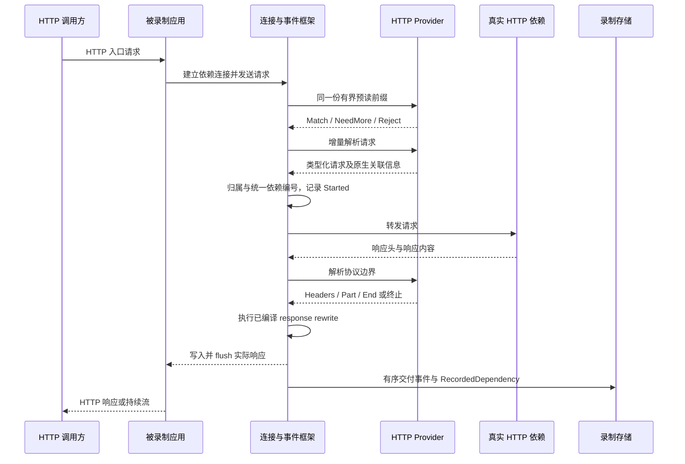

# 依赖协议与顺序回放

## 目标与边界

新增依赖协议时，实现协议识别、增量解码、请求响应关联、会话状态与编码。
连接管理、预读、缓冲上限、录制归属、编号、持久化、并发等待、交付回执和失败收敛由框架负责。
本轮依赖实现覆盖 HTTP、Redis、MySQL。HTTP 主入口沿用普通请求、SSE 与 Socket.IO 的真实传输驱动。

抽象的必要性来自这些通用职责已经跨协议重复出现。仅包装一个识别函数无法建立完整边界。
协议库必须能独立解释字节和协议状态，框架才能在增加存储或调度能力时复用同一条执行路径。
HTTP 的增量解析采用 Hyper，Redis 与 MySQL 采用类型化帧解码器。应用组合层负责将原生事件交给统一录制与 Replay 生命周期。

## 连接与执行流

录制时框架持有应用侧连接与真实依赖侧连接。Replay 时框架持有应用侧连接，协议编码器生成模拟依赖的响应。
依赖可以复用连接、使用流水线或由服务端主动发送消息，因此连接与依赖调用分别编号。



识别采用增量预读。Provider 返回 `NeedMore` 时，框架继续在字节上限和超时内读取。
读满固定长度会阻塞短请求与服务端先发协议。MySQL greeting 从服务端方向识别，TLS 升级边界保留原始字节。
多个 Provider 同时识别成功属于歧义，框架返回明确错误。

## 核心 contract

`traffic-protocol` 提供 `DependencyProvider`、`FrameDecoder`、`EventHandler<Message>` 和共享缓冲读取。
`recognize(Probe)` 接受方向及只读前缀。`decode` 消费框架提供的 `BytesMut`，`encode` 输出原生帧。
`parse` 把类型化消息交给 `EventHandler`。`read_size` 表达下一步帧读取需求，MySQL 使用该接口保护 SSLRequest 边界。

`DependencyProvider` 使用对象安全的 `name(&self)`、`recognize(&self, Probe)` 和 `create_session(&self)`。
`ProviderRegistry` 持有 `Arc<dyn DependencyProvider>`，启动组装时注册或替换实现，各个录制与回放实例持有自己的不可变注册表。
公共 `Session` 保存原生会话接口，协议适配器在连接建立时完成一次类型绑定。
MySQL 与 Redis 使用 `Box<dyn FrameDecoder<Frame = ...>>`，HTTP 使用 `Box<dyn HttpConnectionSession>` 配置 Hyper 原生连接驱动。
公共缓冲器支持 `dyn FrameDecoder` 和 `dyn EventHandler`，帧解析保留原生 Rust 类型及现有字节引用。
HTTP 的请求、body、upgrade 和流式状态由 Hyper 驱动，配置后的连接继续使用原有具体类型。

`traffic_e2e::protocols` 是应用组装入口。调用方可以克隆默认注册表并替换某个 Provider，随后通过
`AppState::new_with_providers` 或 `run_replay_with_providers` 注入实例。
默认入口使用同一套动态注册与会话创建流程。协议识别通过实例注册表执行，原生读取器按连接复用会话。

HTTP Provider 使用 Hyper 的原生 HTTP/1 connection driver，保留流式 body 与 upgrade。
MySQL Provider 还提供逻辑结果边界识别，列定义整体对应 Headers，每个逻辑行对应 Part。
物理 continuation packet 的数量由编码层处理。

协议负载使用具体 Rust 类型。框架持久化 `RecordedDependency<T>` 时只要求负载满足序列化规则。
请求方法、URL、SQL、Redis 参数、MySQL 列等信息保留在各自类型内。
框架自有的关联字段、归属、完整性、编号及 outcome 位于统一 envelope。

应用层的 `DependencyRequestAdapter` 接入共享 observe/select/wait/cancel 执行过程。
原生 adapter 提供本协议的请求投影、值规则匹配、会话约束和交付证据。
普通有限依赖通过共享 `Lifecycle` 和 `ClaimTicket` 完成 once-only 消费。
响应与真实终止均由实际 I/O 回执推进。

`ProtocolMessage` 投影原生结构和物理值，并通过 `locate` 解析协议自己的位置选择器。
`ValueRule` 只描述字段语义，`RuleBinding` 分别绑定原生位置、codec 与逻辑指针。
共享 `PreparedMessage` 执行规则、严格比较未选字段并生成身份对应提案，交付修改通过相同规则和 codec 校验后交回原生编码器。
`evidence` 由协议提供证据视图。HTTP 路径段与 body、Redis key/field/value、MySQL 参数与 SQL 字面量已覆盖同一身份规则的接口测试。
现有完整协议执行路径仍在接入这些能力，应用入口的封闭协议分派和录制事件分派还需要继续迁移。

`EvidenceRegistry` 由 Provider 安装原生证据能力，同一事件类型具有唯一注册者。
录制清单与 Replay 准备使用相同的能力注册表，准备缓存也绑定证据能力的 schema 版本。
`ProtocolRef` 保存协议名和原生身份字段，既有 HTTP/MySQL/Redis 引用保持原来的序列化结构。

## 录制结构

| 结构 | 单位 | 内容 |
| --- | --- | --- |
| Recording manifest | 一次录制 | schema、recording/run 身份、Source 与网络信息、Case 清单、完整性与索引 |
| `RecordedCase` | 一个入口 Case | Case ID、录制路径、完成状态，依赖归属由冻结索引解析 |
| `RecordedDependency<T>` | 一次依赖调用 | 统一 capture metadata、outcome、capture complete 和协议负载 |
| `RecordedEvent<E>` | 一个观察事件 | 全局事件 sequence、单调 offset 和类型化事件 |

同一次录制中的 Global、Case 和暂未归属依赖共用 `RecordingClock`。
`(recording_id, dependency_sequence)` 标识一次依赖调用，`exchange_id` 提供独立 UUID。
事件 sequence 使用另一套单调计数，表达不同依赖间的交错。
请求起始事件与依赖编号在同一临界区分配，分配发生在观察点并先于异步存储。

`dependencies.jsonl` 保存 Replay 所需的语义依赖。
`dependency-lifecycle.jsonl` 保存 Started、协议绑定、输出开始与交付完成、真实终止、入口输入与封存事件。
框架在字节可见前预留输出开始序号，实际 flush 后提交开始事实并分配交付完成序号。
Replay 在输出开始时允许 I/O，交付回执按录制顺序提交。前一次完成回调延迟时，后续请求仍可按真实交错接纳。
`dependencies-debug.jsonl` 承载可选协议调试信息。
HTTP rewrite 的规则身份、策略指纹、原始与交付 body digest、原始解码 body 随 capture metadata 保存。

## Replay 与 Fast

准备阶段认证 Source，建立一次共享 `SequenceCatalog`，并按冻结归属编译 `SequencePlan`。
Case 使用自己的有限依赖投影。会话级依赖按初始化单元与 Source task 保留 cursor，跨 Case 继续消费。
同一 Source task 的各次 invocation 继续遵守录制事件顺序。
两者使用同一份录制事件编号，并保持各自有效 Source 范围内的原始顺序。
显式 native repeat、state observation 与 coalescing 规则保留其 Source 证明、覆盖核算和真实交付 owner。

普通有限请求只与当前 Source slot 比较。提前请求进入有界 pending，总上限为 256 个请求与 64 MiB。
缺失前置请求等待 250 ms 后形成当前归属版本下的去重诊断。
输出屏障使用独立通知，HTTP 分片推进会唤醒正在等待输出的任务。
请求到达索引在首次观察时分配，重试复用同一次 Target 观察。

```text
Source  a.request, b.request, a.part, b.end, a.end
Target  b 提前到达 → pending
        a 到达并匹配 → a admitted
        b 重试并匹配 → b admitted
        a.part flush → 推进
        b.end flush → b consumed
        a.end flush → a consumed
```

`SequenceRuntime` 使用 dense slots、当前 cursor 和 generation-bound delivery ticket。
匹配与交付分离。输出先 reserve，成功 write/flush 或观察到指定终止后 publish，语义提交成功后完成消费。
已完成的 I/O 回执可以等待其事件位置，其他连接继续接纳请求，调度器在前置事件完成后自动提交已到达回执。
丢弃、取消或失败的交付会使 claim 失败并唤醒等待方。

Fast 跳过完整响应的录制耗时，并压缩允许跳过的流式间隔。
错误响应与服务端发起的 FIN/RST 同样压缩等待，响应前缀成功交付后才执行服务端终止。
客户端取消仍需由真实客户端发起，录制的 FIN/RST、关闭方向和作用域参与验证。
Socket.IO 原生输入、通知和 ACK 驱动保留实际输入与交付证据，HTTP close timeline 保留实际关闭屏障。

Redis 的连接 reader 可以在首个响应等待期间继续接纳同连接的后续请求，writer 保持 RESP 回复顺序。
MySQL 结果集按逻辑 Headers、Row、End 交付，相邻行可在一次 flush 后批量发布回执。
批量发布只覆盖连续同依赖 Part，遇到其他请求、依赖或 terminal 时停止。

## HTTP response rewrite 与规则

响应改写使用声明式文档规则。规则编译发生在启动与规则准入阶段。
框架负责 HTTP 选择、压缩解码、字节限制、DNS/路由注册、真实交付和 provenance。
纯内核负责文档解析、选择、地址发现、显式内容变换与 materialize。

规则支持 request query 和响应 JSON `when` 条件、嵌套 JSON/YAML、通配路径、递归地址字段。
地址格式包括 URL、`host:port`、IPv4 与其 sibling port field。
URL 改写保留原 authority 的端口语义以及 credentials、path、query、fragment 的原始文本。
`remove`、`set`、`take` 明确声明拓扑变换。
这些操作与普通地址替换分别记录在可审查的策略中。

```yaml
http:
  response_rewrite:
    - host: config.example.test
      method: GET
      path: /1/config/service
      documents:
        - query: {action: [lookup]}
          when: {/code: 200}
          decode: [{path: /body/nodes/*/value, codec: yaml}]
          fields:
            - {path: /*/master, format: host_port, protocol: redis, recursive: true}
            - {path: /*/slave, format: host_port, protocol: redis, recursive: true}
```

Vintage、CacheService 的业务选择通过配置表达。Kubeconfig 所需的进程、临时凭证文件与路由生命周期仍由框架现有 owner 负责。
规则变化通过现有 Source proof、plan/apply 和新录制义务进入验证。
Replay 的值规则复用现有类型化值 contract，并独立保留 native 会话与有限消费约束。

## Workspace 与迭代拆分

| lib | 主要职责 |
| --- | --- |
| `traffic-model` | 录制身份、归属、完整性、outcome、事件 envelope |
| `traffic-protocol` | Provider contract、识别注册与统一有界帧读取 |
| `traffic-protocol-http` | Hyper connection driver 与响应流模型 |
| `traffic-protocol-mysql` | MySQL wire、continuation、SQL 解析与结果边界 |
| `traffic-protocol-redis` | RESP framing、命令与消息解释 |
| `traffic-recording` | 共用录制时钟与发号 |
| `traffic-replay` | 编译事件计划、通用候选索引、有限 claim、请求等待执行、pending 与真实回执 |
| `traffic-contract` | Scalar/JSON/Protobuf codec、字段契约类型、时间运算与共享身份提案和状态 |
| `traffic-response-rewrite` | 纯声明式文档改写内核 |

根 crate 组合配置、存储、网络、规则准入、Recorder/Replay runtime 与 backend-rewrite 工作流。
下层 lib 的依赖方向指向模型与协议 contract。
后续按已稳定的责任继续提取 semantic capture、存储索引与值规则执行，逐次迁移正常入口并运行 workspace 验证。

## 验收

运行 workspace fmt、test、Clippy 与代码组织检查。
重点验证提前请求、缺失前置、流水线、流式分片、真实 flush、取消、FIN/RST、MySQL TLS 和 rewrite 规则。
性能验证覆盖十万依赖调度以及大结果集分段交付。
发布引擎镜像后，在目标仓库更新 tag/digest，构建录制容器、真实录制、正常停止封存，再以新录制执行正式 API Fast 回归。
