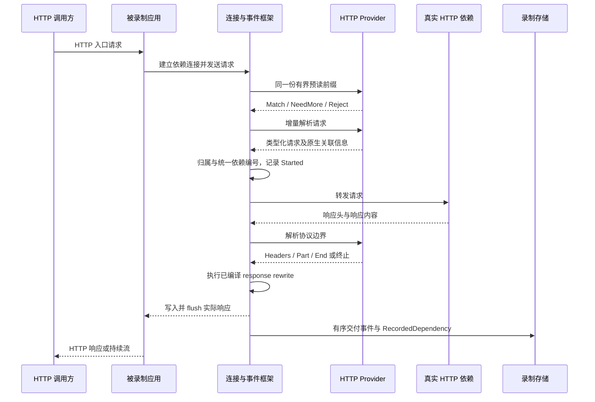

# 依赖协议与顺序回放

## 目标与边界

新增依赖协议时，实现协议识别、增量解码、请求响应关联、会话状态与编码。
连接管理、预读、缓冲上限、录制归属、编号、持久化、并发等待、交付回执和失败收敛由框架负责。
本轮依赖实现覆盖 HTTP、Redis、MySQL。HTTP 主入口沿用普通请求、SSE 与 Socket.IO 的真实传输驱动。

Memcached、Kafka、Motan 的内置录制与 Replay 驱动已移除，Motan 主入口 gateway、就绪探测及配置命令也已移除。
旧的 `motan_gateway` 配置会被拒绝。历史依赖记录在准备回放时必须找到实际安装的 Provider，否则返回缺少实现的错误。
恢复这些协议通过注册独立实现接入通用原生记录路径，证据事件名由实际 Provider 持有。
历史报告的格式解码仍用于读取既有审计结果，当前会话报告只创建已启用协议的执行状态。

抽象的必要性来自这些通用职责已经跨协议重复出现。仅包装一个识别函数无法建立完整边界。
协议库必须能独立解释字节和协议状态，框架才能在增加存储或调度能力时复用同一条执行路径。
HTTP 的增量解析采用 Hyper，Redis 与 MySQL 采用类型化帧解码器。应用组合层负责将原生事件交给统一录制与 Replay 生命周期。

## 连接与执行流

录制时框架持有应用侧连接与真实依赖侧连接。Replay 时框架持有应用侧连接，协议编码器生成模拟依赖的响应。
依赖可以复用连接、使用流水线或由服务端主动发送消息，因此连接与依赖调用分别编号。



识别采用增量预读。Provider 返回 `NeedMore` 时，框架继续在字节上限和超时内读取。
读满固定长度会阻塞短请求与服务端先发协议。MySQL greeting 从服务端方向识别，TLS 升级边界保留原始字节。
多个 Provider 同时识别成功属于歧义，框架返回明确错误。

## 核心 contract

### Policy、codec 与协议的依赖方向

Policy 的输入是标准 value、逻辑位置与独立观察到的上下文。适用性、比较、变换和证据分析由注册的 Policy 实现提供。
相同的实现通过位置绑定应用到 HTTP、Redis、MySQL，以及 JSON、Protobuf 等不同的值表示。
逻辑字段类型由 `traffic-value::schema` 定义，codec 提供这些类型信息，Policy 据此验证自身适用性。

协议拥有请求与响应的原生位置、录制负载、解码、会话约束和服务端 framing。
Codec 拥有字节识别、结构遍历、类型与 presence，以及保留原始数据的重编码。
绑定层组合协议位置、codec 声明、逻辑字段与 Policy 定义。共享执行层使用这些接口准备值、执行 Policy、收集结果并交付。
录制、Replay 和 API 状态机通过标准观察与能力接口驱动相同的实现，应用入口负责安装具体协议、codec 和 Policy。

当前 `traffic-policy-schema`、`traffic-policy-compiler`、`traffic-policy-document` 仍包含历史的协议位置声明、SQL 验证和具体 codec 兼容处理。
这些职责需要继续迁入协议与 codec 的绑定能力，编译入口接收注册表提供的验证、位置覆盖和静态字段描述。
变换接口接收标准 value，并返回变换值及其授权逻辑位置。`traffic-policy-value::transformation` 选择 Source codec、保留原始 document 并委托同一 codec 编码结果。
Response rewrite 的历史嵌套 JSON/YAML 解码仍需继续移入 codec 绑定能力。
完成这些迁移后，依赖检查需要覆盖共享契约、具体实现、应用组装和正常运行入口。

实施按依赖方向推进。

1. 收敛标准 value、逻辑字段描述与变换结果。由执行层识别和固定 Source codec，并通过同一 codec 编码授权修改。
2. 把原生位置选择、位置覆盖关系、录制解码和 Source 原生约束移入协议能力。编译和证据接口委托注册的能力完成验证。
3. 将 `src/policy/runtime` 中的协议实现归入对应协议库，共享值执行、身份对应、时钟和证据提交通过 host 接口提供。
4. 完成现有 HTTP、Redis、MySQL 录制与服务驱动对共享流程的接入。Replay 持有 Case、等待、有限消费与交付回执，应用入口组合实际安装项。
5. 检查 `src` 体积与真实依赖图，验证策略 feature 的增删，随后构建新版引擎并录制五个简单 API Case 完成真实回归。

### 原生服务与录制数据

MySQL 的 `server` 模块拥有命令循环、原生 session、预处理语句标识与参数类型，以及文本和二进制结果的输出选择。
`ServerHost` 提供请求选择、交付、语句元数据与观察回调。应用绑定持有 Case、事务归属、证据和有限消费，实际输出使用共享交付流程。
HTTP 的 `recorded` 模块验证原生响应、完整流与取消前缀，并还原录制代理实际交付的失败响应。
应用提供认证过的清理许可和延迟负载状态。

已交付值的位置由协议生成不透明的 `ValueOrigin`。HTTP 交换、Redis 存储值和 MySQL 物理列的规范化与组成由各自协议库定义。
共享 provenance 存储使用位置指纹与逻辑字段验证因果关系。协议库保持既有位置指纹，保护历史录制数据的对应关系。

`traffic-protocol` 提供 `DependencyProvider`、`FrameDecoder`、`EventHandler<Message>` 和共享缓冲读取。
`recognize(Probe)` 接受方向及只读前缀。`decode` 消费框架提供的 `BytesMut`，`encode` 输出原生帧。
`parse` 把类型化消息交给 `EventHandler`。`read_size` 表达下一步帧读取需求，MySQL 使用该接口保护 SSLRequest 边界。

`DependencyProvider` 使用对象安全的 `name(&self)`、`recognize(&self, Probe)` 和 `create_session(&self)`。
`ProviderRegistry` 持有 `Arc<dyn DependencyProvider>`，启动组装时注册或替换实现，各个录制与回放实例持有自己的不可变注册表。
公共 `Session` 保存原生会话接口，协议适配器在连接建立时完成一次类型绑定。
MySQL 与 Redis 使用 `Box<dyn FrameDecoder<Frame = ...>>`，HTTP 使用 `Box<dyn HttpConnectionSession>` 配置 Hyper 原生连接驱动。
公共缓冲器支持 `dyn FrameDecoder` 和 `dyn EventHandler`，帧解析保留原生 Rust 类型及现有字节引用。
HTTP 的请求、body、upgrade 和流式状态由 Hyper 驱动，配置后的连接继续使用原有具体类型。

`traffic_e2e::protocols` 是应用组装入口。调用方可以克隆默认注册表并替换某个 Provider，随后通过
`AppState::new_with_providers` 或 `run_replay_with_providers` 注入实例。
默认入口使用同一套动态注册与会话创建流程。协议识别通过实例注册表执行，原生读取器按连接复用会话。

HTTP Provider 使用 Hyper 的原生 HTTP/1 connection driver，保留流式 body 与 upgrade。
MySQL Provider 还提供逻辑结果边界识别，列定义整体对应 Headers，每个逻辑行对应 Part。
物理 continuation packet 的数量由编码层处理。

协议负载使用具体 Rust 类型。框架持久化 `RecordedDependency<T>` 时只要求负载满足序列化规则。
请求方法、URL、SQL、Redis 参数、MySQL 列等信息保留在各自类型内。
框架自有的关联字段、归属、完整性、编号及 outcome 位于统一 envelope。

应用层的 `DependencyRequestAdapter` 接入共享 observe/select/wait/cancel 执行过程。
原生 adapter 提供本协议的请求投影、值规则匹配、会话约束和交付证据。
普通有限依赖通过共享 `Lifecycle` 和 `ClaimTicket` 完成 once-only 消费。
响应与真实终止均由实际 I/O 回执推进。

`ProtocolMessage` 投影原生结构和物理值，并通过 `locate` 解析协议自己的位置选择器。
`ValueRule` 只描述字段语义，`RuleBinding` 分别绑定原生位置、codec 与逻辑指针。
共享 `PreparedMessage` 执行规则、严格比较未选字段并生成身份对应提案，交付修改通过相同规则和 codec 校验后交回原生编码器。
`evidence` 由协议提供证据视图。HTTP 路径段与 body、Redis key/field/value、MySQL 参数与 SQL 字面量已覆盖同一身份规则的接口测试。
现有 HTTP、Redis、MySQL 的完整执行路径仍在接入这些能力，旧路径中的具体协议状态和分派还需要继续迁移。

注册标识 `ProtocolId` 接受协议库声明的名称。应用注册表同时保存原生能力和协议无关的值规则绑定。
`NativeProtocol` 提供录制会话、服务会话、Source 交换投影及原生 endpoint 提取。
`CaptureSession` 通过 `CaptureHost` 申请录制许可，并在实际输出 flush 后提交输出回执。
`ServerSession` 持有传输，可处理握手、TLS 升级与原生会话控制。
它把业务请求交给 `RequestHost`，通过框架提供的 `ResponseDelivery` 执行实际响应交付。
框架执行 Source 候选选择、规则校验、有界等待和有限消费，协议会话提供原生 framing。

共享 `ExchangeInventory` 按协议标识、endpoint、归属和原生结构建立 postings。
录制原生字段由协议解释，框架使用 capture UUID 解析有限尾部义务。
Case 流水线采用独立的请求接纳与交付屏障，会话级 lane 继续要求前置真实交付。
派生响应在实际交付前读取已接纳的共享身份，按当时的独立观察时钟生成并校验。
绑定签名包含原生位置、codec、字段语义、运行期时间锚点和显式重编码许可，并参与保护证据的策略身份。

开发用 `traffic-protocol-fixture` 通过正常 TCP 入口录制真实请求和响应，随后封存并进入正常 Replay 入口。
测试覆盖即时和延迟加载、共享身份规则、原生响应编码、真实交付、未选字段拒绝及未消费核算。
该协议使用自己的证据负载和 endpoint 格式，扩展实现集中在独立协议库与应用注册处。

`EvidenceRegistry` 由 Provider 安装原生证据能力，同一事件类型具有唯一注册者。
录制清单与 Replay 准备使用相同的能力注册表，准备缓存也绑定证据能力的 schema 版本。
`ProtocolRef` 保存协议名和原生身份字段，既有 HTTP/MySQL/Redis 引用保持原来的序列化结构。

`CaptureEvidence` 提供原生引用、完整性、控制观察与语义义务。
ledger 使用这些事实执行统一的生命周期、归属与封存，HTTP/MySQL/Redis 的原生完整性和控制判断由协议库实现。
序列化检查在分配兜底依赖编号之前完成，原生负载保留自己的字段，框架写入统一录制 envelope。
自定义事件测试覆盖共享 ledger、封存清单与 scope 索引，并验证未注册的语义义务继续计入 unsupported inventory。

录制写入队列接收通用 `CapturedEvent`，原生事件在入队时完成负载和 capture facts 的快照。
`EvidenceAdapter` 提供通用流量观察与原生摘要聚合器，进程流量汇总按注册能力调用。
Redis snapshot 计数器属于 Redis 协议库。框架通过开放的摘要字段保存结果，既有摘要字段继续可读。
自定义事件通过正常写入队列生成原生摘要的测试也覆盖了这条接口。

MySQL 的录制 FIFO、continuation 组装、预处理语句状态、逻辑响应边界和终止前缀验证由协议库维护。
Redis 的录制会话控制、认证字段脱敏、已确认订阅及原始订阅锚点也由协议库维护。
HTTP 协议库提供有界 body capture、Content-Encoding 解码与 header 脱敏。
框架使用相同的操作分类事实执行录制访问策略，保存请求原来的归属，并在实际 I/O 后发布回执。

协议无关的 transport 接口提供 FIN/RST 观察、单调终止时钟与解析失败后的透明转发。
MySQL 的录制投影通过 `RecordSource` 读取自身原生结果格式，存储实现负责认证原来的文件位置与内容。
延迟加载继续保留列信息、行形状与会话事实，真实响应交付按需加载完整原生结果。

`CaptureFacts` 显式提供统一 outcome，协议实现把自己的原生状态转换为框架的结果事实。
Snapshot 校验共享传输约束及信封一致性，ledger 据此写入统一 envelope。
`EvidenceAdapter` 解释协议自己的安全字段，包括既有协议的 `replay_safe`。
共同的录制完整性仍由证据注册表检查。

MySQL 协议库根据原来的有序录制位置分析 session control、只读前缀、完整事务及有界失败原因。
调用方提供已经解析的原生交换迭代器和共享归属范围，框架安装这些事实并执行实际 Target 接纳与交付覆盖。
协议分析复用同一套 endpoint、用户名、database 和原生状态转换事实。

原生事务与隔离级别约束通过只读 `SessionContext` 获取录制交换、接纳和真实交付事实。
MySQL 协议库维护同一连接的事务成员顺序、首读等价组、隔离级别基线与恢复约束。
Replay 提供输入时间窗口、共享规则的完整比较结果和实际发送回执，负责更新有限消费状态与报告。
`RecordSource::byte_len` 由存储实现提供认证长度，原生有界证据投影据此控制读取预算。

MySQL 录制的连接入口、TLS 协商、认证、FIFO、逐包 flush 和终止处理由协议库的完整连接驱动执行。
应用组装入口实现其宿主接口，提供访问策略、证书、归属、持久化和交付回执。
拒绝请求与无响应命令的完成凭据在实际 flush 后提交，写入失败时保留未完成录制义务。

`MessageEncoder::output` 提供原生输出流，协议声明有限的 Headers、Part、End 边界并编码分块。
共享 Replay 交付器执行实际 write/flush、序列屏障与连续 Part 回执，调用方提交最后的 wire 回执和语义消费。
MySQL 普通响应、结果集、PREPARE 元数据和 continuation 使用该接口，已注册的自定义协议使用同一执行路径。
协议可以把一个逻辑输出事件拆成多个字节块，框架在完整事件 flush 后发布回执。

## 录制结构

| 结构 | 单位 | 内容 |
| --- | --- | --- |
| Recording manifest | 一次录制 | schema、recording/run 身份、Source 与网络信息、Case 清单、完整性与索引 |
| `RecordedCase` | 一个入口 Case | Case ID、录制路径、完成状态，依赖归属由冻结索引解析 |
| `RecordedDependency<T>` | 一次依赖调用 | 统一 capture metadata、outcome、capture complete 和协议负载 |
| `RecordedEvent<E>` | 一个观察事件 | 全局事件 sequence、单调 offset 和类型化事件 |

同一次录制中的 Global、Case 和暂未归属依赖共用 `RecordingClock`。
`(recording_id, dependency_sequence)` 标识一次依赖调用，`exchange_id` 提供独立 UUID。
事件 sequence 使用另一套单调计数，表达不同依赖间的交错。
请求起始事件与依赖编号在同一临界区分配，分配发生在观察点并先于异步存储。

`dependencies.jsonl` 保存 Replay 所需的语义依赖。
`dependency-lifecycle.jsonl` 保存 Started、协议绑定、输出开始与交付完成、真实终止、入口输入与封存事件。
框架在字节可见前预留输出开始序号，实际 flush 后提交开始事实并分配交付完成序号。
Replay 在输出开始时允许 I/O，交付回执按录制顺序提交。前一次完成回调延迟时，后续请求仍可按真实交错接纳。
`dependencies-debug.jsonl` 承载可选协议调试信息。
HTTP rewrite 的规则身份、策略指纹、原始与交付 body digest、原始解码 body 随 capture metadata 保存。

## Replay 与 Fast

准备阶段认证 Source，建立一次共享 `SequenceCatalog`，并按冻结归属编译 `SequencePlan`。
Case 使用自己的有限依赖投影。会话级依赖按初始化单元与 Source task 保留 cursor，跨 Case 继续消费。
同一 Source task 的各次 invocation 继续遵守录制事件顺序。
两者使用同一份录制事件编号，并保持各自有效 Source 范围内的原始顺序。
显式 native repeat、state observation 与 coalescing 规则保留其 Source 证明、覆盖核算和真实交付 owner。

普通有限请求只与当前 Source slot 比较。提前请求进入有界 pending，总上限为 256 个请求与 64 MiB。
缺失前置请求等待 250 ms 后形成当前归属版本下的去重诊断。
输出屏障使用独立通知，HTTP 分片推进会唤醒正在等待输出的任务。
请求到达索引在首次观察时分配，重试复用同一次 Target 观察。

```text
Source  a.request, b.request, a.part, b.end, a.end
Target  b 提前到达 → pending
        a 到达并匹配 → a admitted
        b 重试并匹配 → b admitted
        a.part flush → 推进
        b.end flush → b consumed
        a.end flush → a consumed
```

`SequenceRuntime` 使用 dense slots、当前 cursor 和 generation-bound delivery ticket。
匹配与交付分离。输出先 reserve，成功 write/flush 或观察到指定终止后 publish，语义提交成功后完成消费。
已完成的 I/O 回执可以等待其事件位置，其他连接继续接纳请求，调度器在前置事件完成后自动提交已到达回执。
丢弃、取消或失败的交付会使 claim 失败并唤醒等待方。

Fast 跳过完整响应的录制耗时，并压缩允许跳过的流式间隔。
错误响应与服务端发起的 FIN/RST 同样压缩等待，响应前缀成功交付后才执行服务端终止。
客户端取消仍需由真实客户端发起，录制的 FIN/RST、关闭方向和作用域参与验证。
Socket.IO 原生输入、通知和 ACK 驱动保留实际输入与交付证据，HTTP close timeline 保留实际关闭屏障。

Redis 的连接 reader 可以在首个响应等待期间继续接纳同连接的后续请求，writer 保持 RESP 回复顺序。
MySQL 结果集按逻辑 Headers、Row、End 交付，相邻行可在一次 flush 后批量发布回执。
批量发布只覆盖连续同依赖 Part，遇到其他请求、依赖或 terminal 时停止。

## HTTP response rewrite 与规则

响应改写使用声明式文档规则。规则编译发生在启动与规则准入阶段。
框架负责 HTTP 选择、压缩解码、字节限制、DNS/路由注册、真实交付和 provenance。
纯内核负责文档解析、选择、地址发现、显式内容变换与 materialize。

规则支持 request query 和响应 JSON `when` 条件、嵌套 JSON/YAML、通配路径、递归地址字段。
地址格式包括 URL、`host:port`、IPv4 与其 sibling port field。
URL 改写保留原 authority 的端口语义以及 credentials、path、query、fragment 的原始文本。
`remove`、`set`、`take` 明确声明拓扑变换。
这些操作与普通地址替换分别记录在可审查的策略中。

```yaml
http:
  response_rewrite:
    - host: config.example.test
      method: GET
      path: /config/lookup
      documents:
        - query: {action: [lookup]}
          when: {/code: 200}
          decode: [{path: /body/nodes/*/value, codec: yaml}]
          fields:
            - {path: /*/master, format: host_port, protocol: redis, recursive: true}
            - {path: /*/slave, format: host_port, protocol: redis, recursive: true}
```

服务发现和地址改写只有在项目配置显式声明规则后才会启用。Kubeconfig 所需的进程、临时凭证文件与路由生命周期仍由框架现有 owner 负责。
规则变化通过现有 Source proof、plan/apply 和新录制义务进入验证。
Replay 的值规则复用现有类型化值 contract，并独立保留 native 会话与有限消费约束。

## Workspace 与迭代拆分

| lib | 主要职责 |
| --- | --- |
| `traffic-model` | 录制身份、归属、完整性、outcome、事件 envelope |
| `traffic-protocol` | Provider contract、识别注册与统一有界帧读取 |
| `traffic-protocol-http` | Hyper connection driver、响应流模型、body capture 与 content coding |
| `traffic-protocol-mysql` | MySQL wire、continuation、SQL 解析、录制 FIFO、结果投影与原生响应边界 |
| `traffic-protocol-redis` | RESP framing、命令解释、录制会话及确认后的订阅状态 |
| `traffic-recorder` | 共用录制时钟、发号、捕获队列与持久化 |
| `traffic-recording-store` | 已封存 Source 的认证读取与派生索引 |
| `traffic-replay` | 编译事件计划、通用候选索引、有限 claim、请求等待执行、pending 与真实回执 |
| `traffic-contract` | Scalar/JSON/Protobuf codec、字段契约类型、时间运算与共享身份提案和状态 |
| `traffic-response-rewrite` | 纯声明式文档改写内核 |

根 crate 组合配置、存储、网络、规则准入、Recorder/Replay runtime 与 be-replay 工作流。
下层 lib 的依赖方向指向模型与协议 contract。
后续按已稳定的责任继续提取 semantic capture、存储索引与值规则执行，逐次迁移正常入口并运行 workspace 验证。

## 验收

运行 workspace fmt、test、Clippy 与代码组织检查。
重点验证提前请求、缺失前置、流水线、流式分片、真实 flush、取消、FIN/RST、MySQL TLS 和 rewrite 规则。
性能验证覆盖十万依赖调度以及大结果集分段交付。
发布引擎镜像后，在目标仓库更新 tag/digest，构建录制容器、真实录制、正常停止封存，再以新录制执行正式 API Fast 回归。
