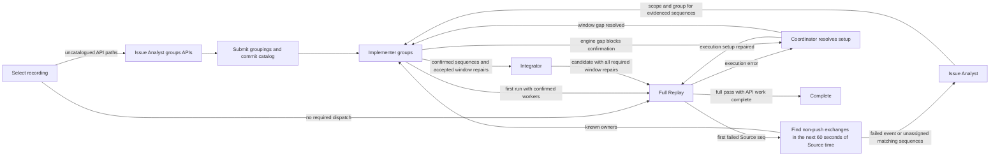

# Source session regression

`traffic-e2e record` captures a globally ordered Source session. Set HTTP
gateway rules before recording to select the ingress workload. The session
includes startup and background traffic at the configured capture points.
Recorder opens ingress at application readiness while already admitted I/O
continues on the same sequence.

Stop the recorder normally to seal the recording. Keep its
`dependency-manifest.json` and the full recording tree together. One
`events.tsv` lists startup, primary HTTP, dependency exchanges, notifications
and shutdown in increasing Source sequence. The first three columns are
`seq`, `offset_us` and the event kind. Sequences can have gaps. An HTTP
response refers to the sequence of its primary request.

Body references name a segment, byte offset and length under `payload/`.
Structured dependency requests and responses each have one `fields-path:`
reference. Embedded binary values remain raw segment slices. Exact protocol
responses such as MySQL zero OK, Redis RESP2 `+OK` and Redis RESP2 null bulk use
`const:` references to a shared response in the sealed dependency term table.
Session dependency rows encode capture phase and default ownership, effect
index and empty Case links in the existing `d=` metadata field.
The `t=` tuple gives the capture clock as a nanosecond offset from the term
table's UTC anchor, followed by request-start and protocol timestamp offsets
relative to that capture clock. A dash leaves the corresponding field outside
the tuple. The monotonic `offset_us` column still drives event ordering.
Recorder publishes `session-summary.live.json` periodically and seals the
final route counts, first request sequences, and capture totals in
`session-summary.json`. Successful TCP connects with no exchange contribute to
connection counts. Observations used for protocol diagnosis remain available
in `observations.tsv`. The Recorder also seals the MySQL driver and transaction
decisions derived from the facts collected as exchanges were recorded.

Replay authenticates timeline chunks as it reads and fills a rolling window in
Source sequence order. Notifications carry their payload reference before the
wire output begins. Ordinary exchanges put their semantic record on the same
timeline when capture completes. A forward reader can look ahead to that row
when Replay reaches its admission, using a temporary file for displaced records
that exceed the in-memory window. Redis notifications and primary HTTP chunks
can use raw bytes through the segment reader. Treat sealed files as read-only
throughout Replay.
During shutdown, the recorder closes admission and gives active ingress up to
15 seconds to finish. It records `primary_cancel` with reason `engine_shutdown`
for each remaining request and disconnects it before stopping Source. Replay
disconnects the corresponding Target request at that event's sequence.
`Stop` requests process shutdown and gives Source up to 15 seconds to exit
after SIGTERM. Business I/O observed during that grace period stays in scope.
If Source outlasts the deadline, Recorder can finish cleanup with SIGKILL.
It records the raw exit status and the verified Recorder-forced disposition.
Recording completeness still depends on the live capture ledger and the normal
seal checks. Replay matches the recorded shutdown events through Source exit
and accepts a Target that completes its requested stop with status 0 or 143.
If an outbound HTTP response is still streaming when Recorder closes the
retained connection after Source exit, the recorder seals the response prefix
only when all captured headers and chunks were flushed. Replay delivers that
prefix at its recorded sequences and leaves the HTTP stream open until the
recorded stop. Outstanding capture failures make the final `recording-run.json`
report `failed` and include the sealed capture failure count.
If Source exits while an outbound HTTP request is still waiting for a response,
Replay matches the request and settles it at Source exit without sending HTTP
headers or a body.
For an outbound HTTP stream cancelled by Source during the run, Recorder retains
the headers and chunks with successful flush receipts. A downstream reset, or
a downstream write-half EOF corroborated by a failed write, supplies the
cancellation boundary. Replay delivers that prefix and observes the Target
client close before advancing.
A server notification stays available as capture evidence if its peer connection
closes before any bytes are written. Replay schedules only delivered
notifications. A partial notification write leaves the capture incomplete.
Protocol adapters handle canonical transport maintenance locally. Replay
validates the evidence for driver setup or cleanup before omitting the
corresponding recorded exchanges from the required sequence.

Place the complete recording under
`.traffic-e2e/local/artifacts/recordings/<run-id>/` in the Target repository.
Initialize the Target once with `be-replay init`. Start with `status` on
`project.delivery.pr_base`, usually `dev-migration`. After the caller approves
a new round, pass the exact 14-digit recording ID to the confirmed command.

```sh
be-replay --target-root /absolute/target status --recording-run-id 20261123161021
be-replay --target-root /absolute/target run --user-confirm --recording-run-id 20261123161021
be-replay --target-root /absolute/target status
```

The confirmed `run` creates a `codex/replay/YYYYMMDD-N` work branch and
selects the recording. For uncatalogued API paths, the engine asks the
coordinator to dispatch an Issue Analyst. After the coordinator submits the
analyst's grouping and `plan` writes `.traffic-e2e/apis.yaml`, commit the
catalog and follow `status` to dispatch the implementation groups.
`advance_required` admits the first Replay while confirmed workers continue
implementing. On a named work branch, `switch-recording-id` changes the active
recording in the current checkout.

```sh
be-replay --target-root /absolute/target switch-recording-id 20261125113932
be-replay --target-root /absolute/target status
```

Plain `run` and `status` use the active recording. Switching back restores
that branch's run key, attempts and assignments for the selected recording.
Switching recordings clears delegated-role and implementer registrations.
The branch retains its catalog and API implementation backlog across recording
changes. Each new attempt replays from Source launch.

`status --recording-run-id ID` previews a different recording and provides
the command to select it. To inspect a specific earlier attempt, supply
`status --attempt-id UUID` with its recording ID and run key when needed to
select the history.
The response includes `recording_id`, `state`, `phase`, `progress`, `session`,
`failure` when available, and `action`. Attempt states are `not_started`,
`running`, `interrupted`, `failed` and `passed`.
Current-round status uses `candidate_changed` when a pass covers older Target
code or inputs or when a different commit supersedes a failure without a
reviewed repair. `session.attempt_id` identifies the attempt. `session` can
also include the Target commit for that attempt. `failure` can give `seq`,
an `expected` event summary, a `reason`, and a `target_observation_id`.
`action` contains a `kind` and a short `summary`, with optional `details` and
`command`. When present, `action.command` is an argument array for
`be-replay`, such as `["status"]`. Historical attempts have `action: null`.

Default `status` shows counts and the coordinator's next action. Where the
action needs supporting detail, `action.query` gives the command to fetch it.
`status --with-assignments` includes worktree reservations, worker runtime
states, assigned scopes, sequence counts, the current window bounds, and ready
fixes and rule plans for integration. Use `sequences` for the complete lists.

The top-level `phase` advances through `preparing_replay`, `building`,
`starting_target`, `replaying`, and `finalizing`, then reaches `complete` after a
pass. Before the first attempt, `phase` and `progress` are `null`.

```json
{"phase":"replaying","progress":{"apis":"0/17","cases":"3/150","events":"17893/942000","previous_events":"4337/942000"}}
```

`progress.events` shows the last reached Source sequence over the sealed
recording's final Source sequence. Source sequence numbers can have gaps.
The numerator reaches the final sequence when Replay completes the timeline.
`progress.previous_events` shows the preceding attempt's endpoint in the same
format when its progress snapshot is available. Older rounds can populate
this field when the next attempt starts.
`progress.cases` counts completed ingress requests over recorded ingress
requests, excluding readiness checks. Matching a recorded cancellation counts
as completing the exchange.
`progress.apis` shows verified API labels over the total from the sealed route
inventory after applying `.traffic-e2e/apis.yaml`. An API label is verified
once all its recorded primary exchanges have completed or matched their
recorded cancellation. An unavailable total appears as `?`.

| `action.kind` | Coordinator action |
| --- | --- |
| `checkout_target_branch` | Check out a named branch. |
| `select_recording` | Obtain the exact ID of a sealed recording. |
| `switch_recording` | Run `action.command` to select the recording on the current work branch. |
| `confirm_regression` | Obtain caller approval and use the confirmed `run` command. |
| `configuration_commit_required` | Review the paths in `action.details.files`, commit the intended configuration, and check `status` again. |
| `setup_required` | Resolve the setup error or route a confirmed engine issue to its owner. |
| `dispatch_task` | Launch the role in `action.details.task` and register its actual runtime handle. |
| `await_delivery` | Follow the registered handle, then submit the agent's artifact or report its exit. |
| `dispatch_required` | Launch one implementer for every assignment without an `agent_handle` and report their handles. |
| `worker_status_required` | Query the agent runtime for the registered handles and report their actual state. |
| `implementation_required` | Follow the registered implementers and submit sequence confirmations, fixes, and rule plans as they arrive. |
| `advance_required` | Run `action.command` to start a full Replay on the selected revision. |
| `wait_required` | Check active Replay or outstanding assignments and use `status` to follow progress. |
| `complete` | The selected revision has passed Replay and required API work is complete. |

The engine checks that `.traffic-e2e/project.yaml`, `.traffic-e2e/apis.yaml`,
and the effective policy are committed before `run`, `plan`, and candidate
publication. Paths in `action.details.files` are relative to the Target root.

Delegated actions carry the task ID, role, requirement, and task-specific
context in `action.details.task`. The requirement is
`api_grouping_required`, `ownership_required`, `lookahead_ownership_required`,
or `integration_required`.
At `dispatch_task`, the coordinator starts the named role in the agent runtime
and asks it to load the `be-replay` skill for its assignment. The coordinator
registers the returned handle with `be-replay report --file FILE`. The engine
then exposes that handle as `task.agent_handle` in `await_delivery`. The
coordinator follows the agent and submits its returned artifact bound to that
task and handle. An exit receipt makes dispatch available again when the agent
stops without delivering.
[Delegated task and receipt contract](../plugins/ai-engine/skills/be-replay/references/session-regression.md#dispatch-and-monitor-delegated-tasks)

A retry with an eligible committed engine revision uses the same Target code,
including any configuration-only commits. Follow the current `status` action
for API dispatch and window confirmation. When it returns `advance_required`
with `action.details.reason` set to `engine_changed`, run the fresh attempt.
The round grants one such retry for each eligible engine revision.



## Inspect evidence

The coordinator handles `setup_required`, including unreadable Source
artifacts. `failure.seq` identifies the Source position when available. An
event failure stops delivery at the first divergence. The engine opens a fixed
60-second window of Source time starting at the failed sequence. Each non-push
sequence linked to a matching Source exchange requires confirmation. Explicit
request links and lifecycle evidence establish ownership when available. The
engine assigns the failed event directly when it knows its owner and requests
`ownership_required` otherwise. It requests `lookahead_ownership_required`
for unassigned window sequences. Unresolved owners and open engine gaps keep
the window open.

Read the exact Source event and page the surrounding timeline using the
recording ID and sequence from status. Use `--from-seq` before the failure to
see preceding requests.

```sh
be-replay --target-root /absolute/target events --recording-run-id ID --seq SEQ
be-replay --target-root /absolute/target events --recording-run-id ID --from-seq 182 --window-seconds 60
be-replay --target-root /absolute/target apis --recording-run-id ID --case-pattern '/reports/*' --from-seq FROM --through-seq THROUGH
```

Use `--after-seq` with the same `--from-seq` and window to continue a page series.
Lower `--from-seq` when the related request precedes the failure. The default
page hides server push notification lifecycle rows and includes client
commands such as Redis `PUBLISH` and `SUBSCRIBE`. Add `--with-push-event` to
show the push rows in a page. Repeat `--seq` to select exact events, including
push rows. Replay still verifies the full recorded sequence. Use
`events --payload` when analysis needs the protected primary HTTP payload.
Use `be-replay dependency <seq>` for the protected request and result
associated with a dependency admission. Use `be-replay target --attempt ID
OBSERVATION_ID` for the authenticated Target observation named by `failure`.
Explicit `--report` remains available for reading a specific report file.
The case-pattern query finds the first matching primary request across HTTP
methods within the inclusive sequence bounds. It returns the actual method,
request sequence, and exchange. Reuse the bounds and pass its
`next_after_sequence` as `--after-seq` to locate the next request.

## Plan, implement, and verify

For a delegated `api_grouping_required` task, the analyst returns a case
pattern and group for each uncatalogued API label. The coordinator submits
those rows with `be-replay plan --findings FILE` and the registered task and
handle. The engine writes the catalog and registers API
implementation work. Commit the catalog before implementer dispatch. A path
that matches an existing pattern inherits that group.
The engine treats previously catalogued APIs as having an implementation and
tracks new HTTP methods independently as they appear in subsequent recordings.
Outstanding implementation work follows the API across recordings of the
branch and closes on accepted integration or a review of existing Target code.

Follow `dispatch_required` and `worker_status_required` for the groups with
implementation work. If all slots are in use, register completed deliveries
to open slots for queued groups. The first Replay can start when every
selected API task has been delivered or is assigned to a worker confirmed
running.

For a requested owner, submit the analyst's `ownership` with the current
`failure.seq`, `scope`, and `group` under the registered task and handle.
The scope uses `api:/case/pattern` and the catalog group for an API, or
`job:NAME`, `startup`, or `shutdown` with the group responsible for the work.
The engine also assigns known owners' lookahead work to these groups. An API
lookahead scope covers its case pattern across methods.
Each active group uses one worker
and a fixed path under `.traffic-e2e/local/rewrite-worktrees/api-implementer-<n>`.
Use `--max-implementers N` to set the concurrency limit from 1 to 16. Slots
are reused across recordings. Only assignments in the selected recording
reserve slots for new dispatch. Switching back restores that recording's
assignment IDs and paths. Use `status --with-assignments` for complete handoffs.
Register the handle returned by the agent runtime with `state: started`.
Query the runtime and report `state: running` for an active implementer or
`state: exited` for an implementer that stopped before delivering. An exited
worker's assignment can be resumed or dispatched again. Refresh an observation
when the engine asks. Check and register workers for the selected recording
after a switch. [Implementer registration](../plugins/ai-engine/skills/be-replay/references/session-regression.md#plan-implement-and-verify)

`be-replay sequences --assignment-id UUID` lists assigned Source sequences
one per line. Use `--scope` to filter an assignment, or `--task-id TASK` to
read outstanding sequences for an ownership analyst. Both accept an
exclusive `--after-seq` and `--limit`. When an implementer can establish a
dependency's owner with an explicit request link or the relevant Source call
path, submit a `claim` receipt anchored to the primary request inside the
window. The analyst submits ownership or unresolved findings with `plan --findings`.

Implementers compare each assigned event's input and output formats and
check the applicable Target branch. They implement missing or mismatched
behavior, run tests specific to their changes, and prepare any required
Source-proven rule plan. Submit the unchanged events with `kind: confirmed`,
`format: matches`, and `rule: not_needed` or `rule: covered`. Use one
`sequences_file` per group and assignment for each shared outcome, with
comma-separated or newline-separated Source sequences. Use
`kind: review` with `confirms_apis: true` for first-run API work verified by
route and handler tests. Register each worker before submitting its delivery.
[Confirmation format](../plugins/ai-engine/skills/be-replay/references/session-regression.md#confirm-window-sequences)

Register an additive rule fragment and its Source evidence with
`be-replay rule plan --file FILE`. The engine requests integration once every
required sequence in the window has a confirmation or accepted repair. The
integrator merges all required fixes and uses `be-replay rule apply` to apply
all required plans as one policy edit in the integration worktree. Deliver
a clean integration immediately. When the merge conflicts, the integrator resolves the
conflicts and runs only tests directly related to the resolution. Review
checks, standalone builds, and Clippy are prohibited for integrators. The
coordinator publishes the candidate and submits its exact commit, included
fixes and included rule plans with the registered task, handle, and current
finished attempt. The candidate receipt's optional `checks` field carries test results from
conflict resolution. The candidate must include all required window fixes
and applied plans. Follow `advance_required` to start a full Replay. The
engine verifies the sequences when Replay reaches them. A full pass closes
the window work. The initial API implementation tasks remain open until the
engine accepts integration or a review that confirms the existing implementation.
[Plan and report formats](../plugins/ai-engine/skills/be-replay/references/session-regression.md#plan-implement-and-verify)

The first `complete` on a delivery candidate starts coordinator-owned final
checks. After they pass, the coordinator runs one final Replay using the same
commit, inputs, and recording. [Pre-final validation and Replay](../plugins/ai-engine/skills/be-replay/references/coordinator.md#pre-final-validation-and-replay)

Session Replay advances recorded I/O on the shared timeline as soon as its
matching request, delivery receipt, or timer gate allows it. Recorded intervals
add zero delay. Target execution and actual I/O still take real time.
Replay timer anchors refer to Source sequences. The engine can wake a graceful
shutdown wait at `source_exit`, after earlier events and final background
notifications have completed. [Replay timer mechanics](replay-timers.md)

Replay keeps identity mappings for the full session so later events can
refer to the same translated values. The sealed mandatory dependency count sets the
identity count budget, and retained values share a fixed memory limit.

Each recorded ingress request contributes one case to its HTTP method and
route in `.traffic-e2e/apis.yaml`. For requests absent from the catalog, the
label uses the literal path. A case is verified when its response or recorded
cancellation completes. Readiness probes and dependency traffic contribute
to event verification only.
The catalog labels the report. The replay workload is determined by the
recording, including all selected ingress, startup, and background events.
Each Session attempt starts at Source launch and matches the entire timeline.

`be-replay run` reports matched event counts and recorded and verified counts
per API. After all events pass in a session with API cases, it adds one
regression to `.traffic-e2e/progress.yaml` and retains existing API history. A sealed recording
contributes once across retries. The route labels used by the first successful
publication remain in the history if the catalog changes later. Failed attempts
and sessions without API cases retain their event reports. Check
`session.passed` for the Replay verdict and `progress_published` for publication.
The run result reports any progress-publication error separately.
