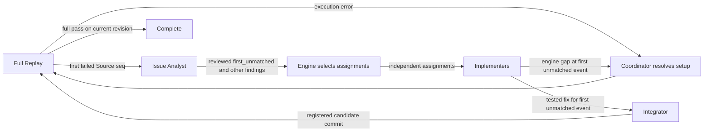

# Source session regression

`traffic-e2e record` captures a globally ordered Source session. Set HTTP
gateway rules before recording to select the ingress workload. The session
includes startup and background traffic at the configured capture points.
Recorder opens ingress at application readiness while already admitted I/O
continues on the same sequence.

Stop the recorder normally to seal the recording. Keep its
`dependency-manifest.json` and the full recording tree together. One
`events.tsv` lists startup, primary HTTP, dependency exchanges, notifications
and shutdown in increasing Source sequence. The first three columns are
`seq`, `offset_us` and the event kind. Sequences can have gaps. An HTTP
response refers to the sequence of its primary request.

Body references name a segment, byte offset and length under `payload/`.
Structured dependency requests and responses each have one `fields-path:`
reference. Embedded binary values remain raw segment slices. Exact protocol
responses such as MySQL zero OK, Redis RESP2 `+OK` and Redis RESP2 null bulk use
`const:` references to a shared response in the sealed dependency term table.
Session dependency rows encode capture phase and default ownership, effect
index and empty Case links in the existing `d=` metadata field.
The `t=` tuple gives the capture clock as a nanosecond offset from the term
table's UTC anchor, followed by request-start and protocol timestamp offsets
relative to that capture clock. A dash leaves the corresponding field outside
the tuple. The monotonic `offset_us` column still drives event ordering.
Recorder publishes `session-summary.live.json` periodically and seals the
final route counts, first request sequences, and capture totals in
`session-summary.json`. Successful TCP connects with no exchange contribute to
connection counts. Observations used for protocol diagnosis remain available
in `observations.tsv`. The Recorder also seals the MySQL driver and transaction
decisions derived from the facts collected as exchanges were recorded.

Replay authenticates timeline chunks as it reads and fills a rolling window in
Source sequence order. Notifications carry their payload reference before the
wire output begins. Ordinary exchanges put their semantic record on the same
timeline when capture completes. A forward reader can look ahead to that row
when Replay reaches its admission, using a temporary file for displaced records
that exceed the in-memory window. Redis notifications and primary HTTP chunks
can use raw bytes through the segment reader. Treat sealed files as read-only
throughout Replay.
During shutdown, the recorder closes admission and gives active ingress up to
15 seconds to finish. It records `primary_cancel` with reason `engine_shutdown`
for each remaining request and disconnects it before stopping Source. Replay
disconnects the corresponding Target request at that event's sequence.
Protocol adapters handle canonical transport maintenance locally. Replay
validates the evidence for driver setup or cleanup before omitting the
corresponding recorded exchanges from the required sequence.

Place the complete recording under
`.traffic-e2e/local/artifacts/recordings/<run-id>/` in the Target repository.
Initialize the Target once with `be-replay init`. Start with `status` on
`project.delivery.pr_base`, usually `dev-migration`. After the caller approves
a new round, pass the exact 14-digit recording ID to the confirmed command.

```sh
be-replay --target-root /absolute/target status --recording-run-id 20261123161021
be-replay --target-root /absolute/target run --user-confirm --recording-run-id 20261123161021
be-replay --target-root /absolute/target status
```

The confirmed `run` creates a `codex/replay/YYYYMMDD-N` work branch, selects
the recording, and verifies the isolated Target from process launch. On a
named work branch, `switch-recording-id` changes the active recording in the
current checkout. Use `run --recording-run-id ID` to select and run in one
command.

```sh
be-replay --target-root /absolute/target switch-recording-id 20261125113932
be-replay --target-root /absolute/target run
```

Plain `run` and `status` use the active recording. Switching back restores
that branch's run key, attempts and reviewed workflow for the selected
recording. Each new attempt replays from Source launch.

`status --recording-run-id ID` previews a different recording and provides
the command to select it. To inspect a specific earlier attempt, supply
`status --attempt-id UUID` with its recording ID and run key when needed to
select the history.
The response includes `recording_id`, `state`, `phase`, `progress`, `session`,
`failure` when available, and `action`. Attempt states are `not_started`,
`running`, `interrupted`, `failed` and `passed`.
Current-round status uses `candidate_changed` when a pass covers older Target
code or inputs or when a different commit supersedes a failure without a
reviewed repair. `session.attempt_id` identifies the attempt. `session` can
also include the Target commit for that attempt. `failure` can give `seq`,
an `expected` event summary, a `reason`, and a `target_observation_id`.
`action` contains a `kind`, a short `summary`, and any `details` and `commands`
for the coordinator to act on. `commands` contains workflow argument lists,
such as `action.commands.plan` or `action.commands.run`. Status for a historical
attempt has `action: null`.

The top-level `phase` advances through `preparing_replay`, `building`,
`starting_target`, `replaying`, and `finalizing`, then reaches `complete` after a
pass. Before the first attempt, `phase` and `progress` are `null`.

```json
{"phase":"replaying","progress":{"apis":"0/17","events":"17893/942000"}}
```

`progress.events` shows the last reached Source sequence over the sealed
recording's final Source sequence. Source sequence numbers can have gaps.
Once Replay completes, both values show the final sequence.
`progress.apis` shows verified API labels over the total from the sealed route
inventory after applying `.traffic-e2e/apis.yaml`. An API label is verified
once all its recorded primary exchanges have ended or been cancelled in the
matched prefix. An unavailable total appears as `?`.

| `action.kind` | Coordinator action |
| --- | --- |
| `checkout_target_branch` | Check out a named branch. |
| `select_recording` | Obtain the exact ID of a sealed recording. |
| `switch_recording` | Use the returned `switch` command to select the recording on the current work branch. |
| `confirm_regression` | Obtain caller approval and use the confirmed `run` command. |
| `setup_required` | Resolve the setup error or route a confirmed engine issue to its owner. |
| `analysis_required` | Assign the first divergence to an Issue Analyst and review the findings. |
| `implementation_required` | Dispatch the eligible findings and accept tested fixes as they arrive. |
| `integration_required` | Integrate the selected fixes, validate and publish the candidate, and submit its receipt. |
| `advance_required` | Use `action.commands.run` to start a full Replay on the selected revision. |
| `wait_required` | Check active Replay or outstanding assignments and use `status` to follow progress. |
| `complete` | The selected revision has passed Replay. |



## Inspect evidence

The coordinator handles `setup_required`, including unreadable Source
artifacts. `failure.seq` identifies the Source position when available. An
event failure stops delivery at the first divergence. When `action.kind` is
`analysis_required`, keep one active analyst per attempt. Pass the recording
and attempt IDs, `failure.seq`, and the Source and Target repository locations
and revisions. The analyst groups symptoms that appear to share one repair.
The findings JSON names the first failure's group in `first_unmatched` and
includes other groups under optional `others`.

Read the exact Source event and page the surrounding timeline using the
recording ID and sequence from status. Use `--from-seq` before the failure to
see preceding requests.

```sh
be-replay --target-root /absolute/target events --recording-run-id ID --seq SEQ
be-replay --target-root /absolute/target events --recording-run-id ID --from-seq 182 --window-seconds 60
```

Use `--after-seq` with the same `--from-seq` and window to continue a page series.
Lower `--from-seq` when the related request precedes the failure. The default
page hides server push notification lifecycle rows and includes client
commands such as Redis `PUBLISH` and `SUBSCRIBE`. Add `--with-push-event` to
show the push rows in a page. Repeat `--seq` to select exact events, including
push rows. Replay still verifies the full recorded sequence. Use
`events --payload` when analysis needs the protected primary HTTP payload.
Use `be-replay dependency <seq>` for the protected request and result
associated with a dependency admission. Use `be-replay target --attempt ID
OBSERVATION_ID` for the authenticated Target observation named by `failure`.
Explicit `--report` remains available for reading a specific report file.

## Plan, implement, and verify

The coordinator reviews the findings JSON and runs `action.commands.plan`
with the reviewed file. `--attempt-id` binds the findings to the exact
attempt. The first submission must include `failure.seq` in
`first_unmatched.sequences`. Use `others` to add findings to the same attempt.
Each finding contains a free-form `root_cause` string used as a stable group
ID, a `summary`, and `sequences`. Optional `scope` identifies the owner or
lifecycle, such as `startup`, `api:GET /users/{id}`, `job:sync_users`,
`shutdown`, or `shared`. The planner deduplicates findings by group ID and
prioritizes `first_unmatched`, then fills available slots up to
`--max-implementers N` (1 to 16, default 16). The coordinator uses a separate
worktree for each assignment and handles overlapping edits at integration.
Implementers confirm the cause and deliver a tested Target or time, ID, or
token policy repair.
Events after the failure provide context for investigation and receive
verification credit when a later Replay reaches them.

Submit ready fixes with `be-replay report --file FILE`. Each `fixes` receipt
binds the originating attempt to the causes, commits, and checks it delivers.
When an implementer confirms a gap in Replay, the coordinator registers an
`engine_gap` report with the originating attempt, group ID, and observed
evidence. The coordinator routes it to the engine owner and follows
`setup_required` to retry when the gap accounts for the first unmatched
event. Once a fix for that event is ready, the coordinator can integrate
it while independent work continues. The integrator
checks the candidate, and the coordinator publishes and registers its exact
commit. The `candidate` receipt names the current failed attempt, the
published `HEAD`, the included fix commits, and the checks. Follow `status`
to run full Replay against the candidate. [Finding and report formats](../plugins/ai-engine/skills/be-replay/references/session-regression.md#plan-implement-and-verify)

Session Replay advances recorded I/O on the shared timeline as soon as its
matching request, delivery receipt, or timer gate allows it. Recorded intervals
add zero delay. Target execution and actual I/O still take real time.
Replay timer anchors refer to Source sequences. The engine can wake a graceful
shutdown wait at `source_exit`, after earlier events and final background
notifications have completed. [Replay timer mechanics](replay-timers.md)

Replay keeps identity mappings for the full session so later events can
refer to the same translated values. The sealed mandatory dependency count sets the
identity count budget, and retained values share a fixed memory limit.

Each recorded ingress request contributes one case to its HTTP method and
route in `.traffic-e2e/apis.yaml`. For requests absent from the catalog, the
label uses the literal path. A case is verified when its response or recorded
cancellation completes. Readiness probes and dependency traffic contribute
to event verification only.
The catalog labels the report. The replay workload is determined by the
recording, including all selected ingress, startup, and background events.
Each Session attempt starts at Source launch and matches the entire timeline.

`be-replay run` reports matched event counts and recorded and verified counts
per API. After all events pass in a session with API cases, it adds one
regression to `.traffic-e2e/progress.yaml` and retains existing API history. A sealed recording
contributes once across retries. The route labels used by the first successful
publication remain in the history if the catalog changes later. Failed attempts
and sessions without API cases retain their event reports. Check
`session.passed` for the Replay verdict and `progress_published` for publication.
The run result reports any progress-publication error separately.
